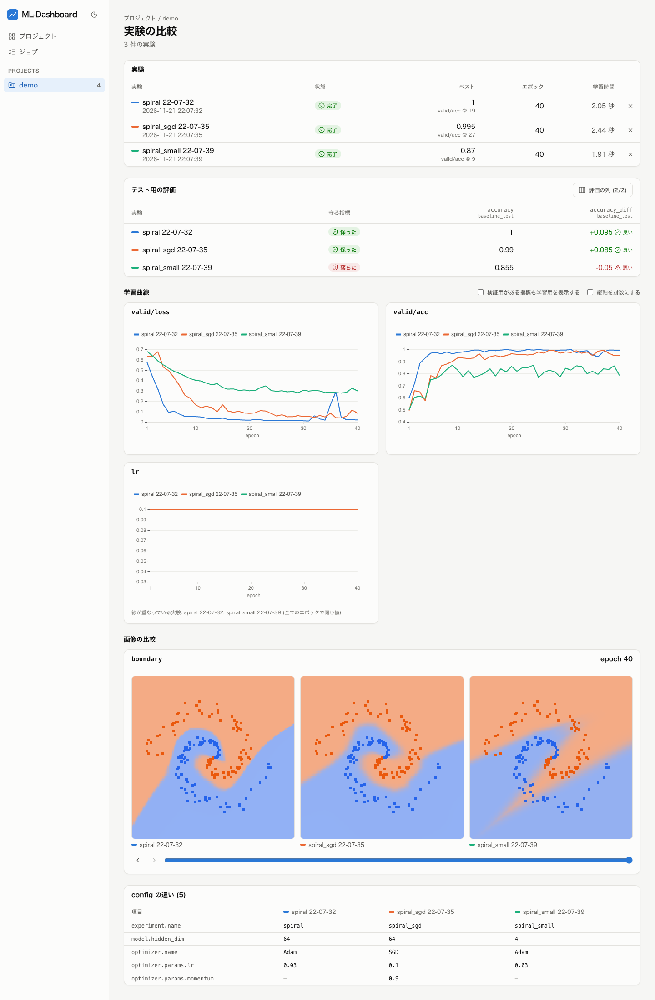
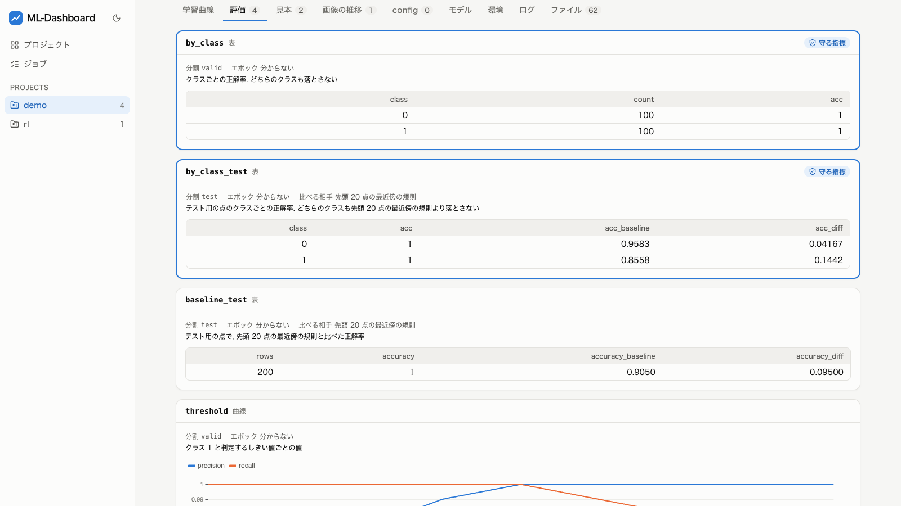
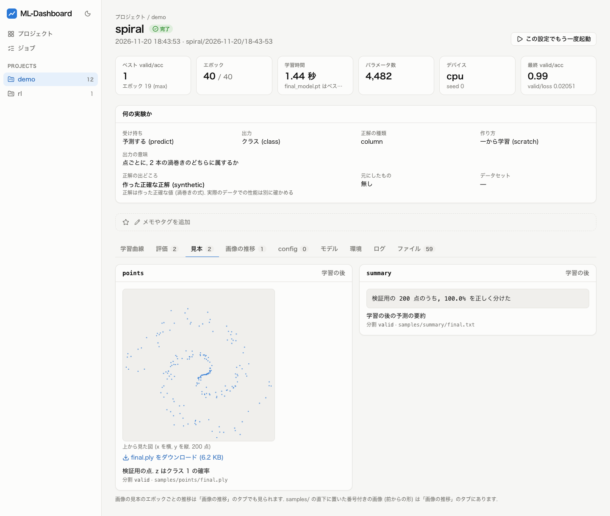
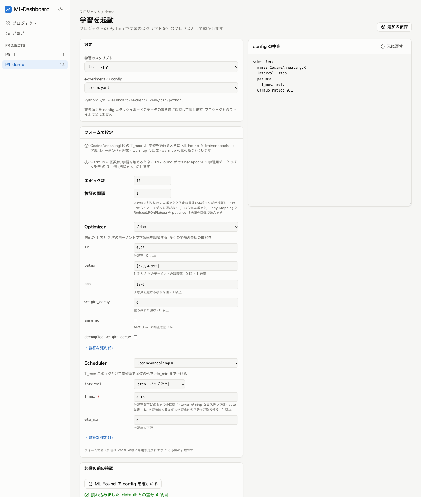
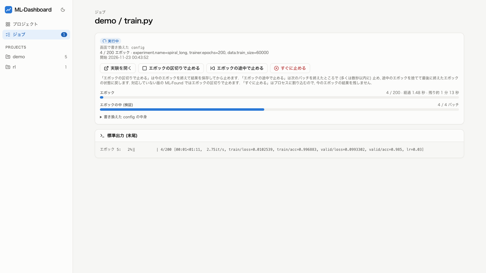
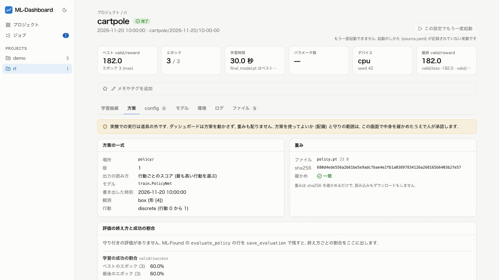

# ML-Dashboard

「機械学習を全て GUI 上で行う」うちの **モデルの学習・評価** の段階を受け持つ, ローカルで動く Web アプリ. 学習のライブラリ [ML-Found](https://github.com/victor-von-pooh/ML-Found) の実験を一覧にして比べ, 画面から学習を起動して止める.

ML-Found が実験ごとに残すディレクトリ (`history.csv`, `config.yaml`, `train.log` など) をそのまま読むので, 学習のコードに手を加えなくても, 既にある実験を見られる.



**実験の比較**. 選んだ実験の学習曲線を指標ごとに重ね, 同じエポックの画像と config の違う項目を並べる.

<table>
  <tr>
    <td width="50%"></td>
    <td width="50%"></td>
  </tr>
  <tr>
    <td><b>評価</b>. 何の実験か (受け持ち, 正解の出どころ) と, データ全体の評価の表と曲線. 守る指標の表を先頭に置く</td>
    <td><b>見本</b>. 名前ごとに, エポックを選んで画像, 文, 音, 点群を見る</td>
  </tr>
  <tr>
    <td></td>
    <td></td>
  </tr>
  <tr>
    <td><b>学習の起動</b>. フォームか YAML で config を書き換え, ML-Found で確かめてから起動する</td>
    <td><b>ジョブ</b>. 進み具合を見て, エポックの区切り, エポックの途中, すぐの 3 通りで止める</td>
  </tr>
  <tr>
    <td></td>
    <td></td>
  </tr>
  <tr>
    <td><b>方策</b>. 強化学習の方策の守りと重みの sha256 を確かめる. 重みは配らず, 使ってよいかは人が承認する</td>
    <td><b>追加の依存</b>. 本体に含めない機能が入っているかと入れ方. 足りなければ学習を起動できない</td>
  </tr>
</table>

図は同梱の `demo/` (2 本の渦巻きを分ける小さなモデル) の実験. 方策と追加の依存の図は, 画面の通しのテストに置いた強化学習の実験 (`frontend/e2e/fixtures/rl/`. 学習せずに置いたもの).

## できること

- **プロジェクト**: ML-Found を使うディレクトリを登録する. 親のディレクトリからまとめて探せる
- **実験の一覧と詳細**: 状態, default との差分, ベストの指標で並べ, 絞り込む. 詳細では学習曲線, 何の実験か, 評価, 見本, 方策, 画像の推移, config, モデル, 環境, ログ, ファイルを見る. メモ, タグ, 星も付けられる
- **比較と分析**: 8 つまでの実験を重ねて比べる. 同じ名前の実験で値を変えた config の項目と結果の関係を見る
- **学習の起動とジョブ**: config を書き換えて ML-Found で確かめてから起動し, 進み具合を見て止める. 実験の設定でもう一度起動できる
- **追加の依存**: 強化学習の環境, MuJoCo, ROS 2, CUDA が入っているかと入れ方を見る

## 使い方

### 必要なもの

- [uv](https://docs.astral.sh/uv/) (Python は uv が用意する. 3.10 以上で, 3.12 と 3.13 で確かめている). ML-Found の依存の PyTorch も入るので, 最初の `make setup` は数 GB を取得し, 回線によって数分かかる
- Node.js 24 以上と [pnpm](https://pnpm.io/) 11 以上 (`corepack enable` で `package.json` の版が入る)
- 画面の通しのテスト (`make e2e`) だけは, 手元の Google Chrome を使う (CI では Playwright の Chromium)

### 導入と起動

```bash
git clone --recursive https://github.com/victor-von-pooh/ML-Dashboard.git
cd ML-Dashboard
make setup   # submodule, Python と Node.js の依存
make demo    # demo のプロジェクトで config を変えた 4 つの実験を作る (CPU で十数秒)
make serve   # 画面をビルドして http://127.0.0.1:8765 で起動 (Ctrl-C で止める)
```

起動すると, 起動ごとのトークンが付いた URL (`http://127.0.0.1:8765/api/auth?token=...`) が表示されるので, それを開く. ダッシュボードは学習のプロセスを起動できるため, トークンを Cookie に保存したブラウザからだけ API を受け付ける.

開いたら「プロジェクトを追加」で, clone したディレクトリの中の `demo` を絶対パスか `~` からのパス (例: `~/ML-Dashboard/demo`) で登録する. 自分のプロジェクトの登録, ポートやデータの置き場の変え方は [docs/GUIDE.md](docs/GUIDE.md) の 1 章と 2 章にある.

## 文書

- [操作ガイド](docs/GUIDE.md): 画面の順の操作ガイド (`demo` だけで試せる)
- [設計](docs/DESIGN.md): 今の設計と決まり (ML-Found との約束, 画面, API)
- [TODO](TODO.md): まだやっていないこと (優先度の順)

## 開発

```bash
make dev-backend    # API (http://127.0.0.1:8765, 変更を自動で反映). 表示された http://localhost:5173/api/auth?token=... を開く
make dev-frontend   # 画面 (http://localhost:5173, API に転送. ポートを変えた場合は両方に PORT=... を付ける)
make check          # lint, 型検査, テスト
make e2e            # 画面の通しのテスト (Playwright). デモの実験を作ってからダッシュボードを起動して操作する
make api            # バックエンドの API を変えたら, 画面の型を作り直す
```

| ディレクトリ | 内容 |
| --- | --- |
| `backend/` | API (Python, FastAPI). `core/` が ML-Found の出力の読み込み, `api/` がルーティング |
| `frontend/` | 画面 (TypeScript, React, Vite). `src/api/schema.d.ts` は OpenAPI から生成した型 |
| `demo/` | 動作の確認と画面の通しのテストに使う ML-Found のプロジェクト |
| `frontend/e2e/` | 画面の通しのテスト (Playwright) |
| `ML-Found/` | submodule |
| `docs/GUIDE.md` | 画面ごとの使い方と, 試す手順 |
| `docs/DESIGN.md` | 今の設計と決まり |

## ライセンス

[MIT](LICENSE)
