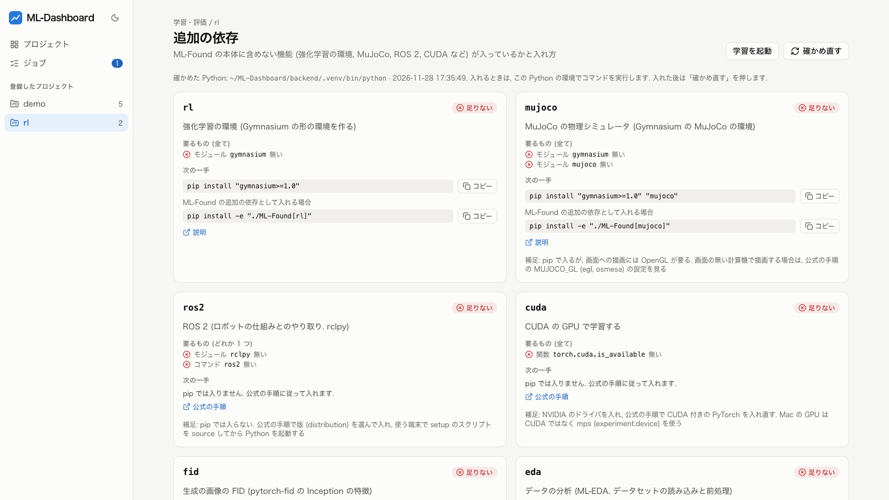

# ML-Dashboard

「機械学習を全て GUI 上で行う」うちの **モデルの学習・評価** の段階を受け持つ, ローカルで動く Web アプリ. 学習のライブラリ [ML-Found](https://github.com/victor-von-pooh/ML-Found) の実験を一覧にして比べ, 画面から学習を起動して止める.

ML-Found が実験ごとに残すディレクトリ (`history.csv`, `config.yaml`, `train.log` など) をそのまま読むので, 学習のコードに手を加えなくても, 既にある実験を見られる.


**実験の比較**. 選んだ実験のテスト用の評価の値と守る指標の印を並べ, 学習曲線を指標ごとに重ね, 同じエポックの画像と config の違う項目を並べる.

<table>
  <tr>
    <td width="50%"></td>
    <td width="50%"></td>
  </tr>
  <tr>
    <td><b>評価</b>. 何の実験か (受け持ち, 正解の出どころ) と, データ全体の評価の表と曲線. 比べる相手との差に良し悪しの印を付け, 群分けの群の安定性や群の要約も並ぶ. 名前の分かる指標には日本語の説明を添え, 守る指標の表を先頭に置く</td>
    <td><b>見本</b>. 名前ごとに, エポックを選んで画像, 文, 音, 点群, 領域, CSV の表を見る. 横に同じエポックの学習用と検証用の指標が並ぶ</td>
  </tr>
  <tr>
    <td></td>
    <td></td>
  </tr>
  <tr>
    <td><b>学習の起動</b>. フォームか YAML で config を書き換え, ML-Found で確かめてから起動する</td>
    <td><b>ジョブ</b>. 進み具合を見て, エポックの区切り, エポックの途中, すぐの 3 通りで止める</td>
  </tr>
  <tr>
    <td></td>
    <td></td>
  </tr>
  <tr>
    <td><b>方策</b>. 強化学習の方策の守りと重みの sha256 を確かめる. 重みは配らず, 使ってよいかは人が承認する</td>
    <td><b>追加の依存</b>. 本体に含めない機能が入っているかと入れ方. 足りなければ学習を起動できない</td>
  </tr>
</table>

図は同梱の `demo/` (2 本の渦巻きを分ける小さなモデル) の実験. 方策と追加の依存の図は, 画面の通しのテストに置いた強化学習の実験 (`frontend/e2e/fixtures/rl/`. 学習せずに置いたもの).

## できること

- **プロジェクト**: ML-Found を使うディレクトリを登録する. 親のディレクトリからまとめて探せる. ML-Pathfinder で書き出したプロジェクトは一覧から選ぶだけで登録できる
- **実験の一覧と詳細**: 状態, default との差分, ベストの指標, テスト用の評価の値 (群分けは全ての行で数えた群の安定性) で並べ, 絞り込む. 守る指標が比べる相手より落ちた実験に印を付ける. 詳細では学習曲線, 何の実験か, 評価, 見本, 方策, 軌跡, 画像の推移, config, モデル, 環境, ログ, ファイルを見る. 強化学習の評価で記録した軌跡から, 環境で動かさずに一様の方策と ε-greedy の方策の良さを見積もれる. メモ, タグ, 星も付けられる
- **比較と分析**: 8 つまでの実験を重ねて比べ, テスト用の評価の値と守る指標の印も並べる. 学習曲線の横軸は, エポックのほかに環境のステップ数などのエポックごとに増え続ける列も選べる. 違うモデルの定義の実験は定義ごとに分けて並べる. 同じ名前の実験で値を変えた config の項目と結果の関係を見る
- **学習の起動とジョブ**: config (エポック数, 検証の間隔, 計算の精度, 勾配の蓄積, Optimizer と Scheduler など) をフォームか YAML で書き換えて ML-Found で確かめてから起動し, 進み具合を見て止める. 実験の設定でもう一度起動でき, 実験に写したモデルの定義で同じモデルを学習し直せる. プロジェクトの `models/` のモデルの定義の候補を選び, 同じ設定で 1 つずつ順に学習して比べられる. 監視する指標を書いていないプロジェクトでは, ML-Pathfinder の問題の設定の監視する指標と向き (ML-Quest の受け渡し) を選んで入れられる
- **学習の準備**: プロジェクトのデータセット, モデルの定義, 学習の環境がそろっているかを見る. 確かめてから, プロジェクトの `.venv` を作って ML-Found と要る機能 (ML-EDA, ML-ModelControl, ML-Inference など) を入れられる
- **追加の依存**: 強化学習の環境, MuJoCo, ROS 2, CUDA, 他の段階のライブラリが入っているかと入れ方を見る

## 使い方

### 必要なもの

- [uv](https://docs.astral.sh/uv/) (Python は uv が用意する. 3.10 以上で, 3.12 と 3.13 で確かめている). ML-Found の依存の PyTorch も入るので, 最初の `make setup` は数 GB を取得し, 回線によって数分かかる
- Node.js 24 以上と [pnpm](https://pnpm.io/) 11 以上 (`corepack enable` で `package.json` の版が入る)
- 画面の通しのテスト (`make e2e`) だけは, 手元の Google Chrome を使う (CI では Playwright の Chromium)

### 導入と起動

```bash
git clone --recursive https://github.com/victor-von-pooh/ML-Dashboard.git
cd ML-Dashboard
make setup   # submodule, Python と Node.js の依存 (問題の設定を読む ML-Quest も. 外す場合は make setup EXTRAS=)
make demo    # demo のプロジェクトで config を変えた 4 つの実験を作る (CPU で十数秒)
make serve   # 画面をビルドして http://127.0.0.1:8765 で起動 (Ctrl-C で止める)
```

起動すると, 起動ごとのトークンが付いた URL (`http://127.0.0.1:8765/api/auth?token=...`) が表示されるので, それを開く. ダッシュボードは学習のプロセスを起動できるため, トークンを Cookie に保存したブラウザからだけ API を受け付ける.

開いたら「プロジェクトを追加」で, clone したディレクトリの中の `demo` を絶対パスか `~` からのパス (例: `~/ML-Dashboard/demo`) で登録する. ML-Pathfinder で書き出したプロジェクトは, 同じダイアログの一覧から選ぶだけで登録できる. 自分のプロジェクトの登録, ポートやデータの置き場の変え方は [docs/GUIDE.md](docs/GUIDE.md) の 1 章と 2 章にある.

## 文書

- [操作ガイド](docs/GUIDE.md): 画面の順の操作ガイド (`demo` だけで試せる「やってみる」付き). 最後の章が「困ったとき」
- [設計](docs/DESIGN.md): 今の設計と決まり (ML-Found との約束, 画面, API, 用語, 置き場, 安全)
- [TODO](TODO.md): まだやっていないこと (優先度の順)

## 開発

```bash
make dev-backend    # API (http://127.0.0.1:8765, 変更を自動で反映). 表示された http://localhost:5173/api/auth?token=... を開く
make dev-frontend   # 画面 (http://localhost:5173, API に転送. ポートを変えた場合は両方に PORT=... を付ける)
make check          # lint, 型検査, テスト
make e2e            # 画面の通しのテスト (Playwright). デモの実験を作ってからダッシュボードを起動して操作する
make api            # バックエンドの API を変えたら, 画面の型を作り直す
make screenshots    # README の画面の図 (7 枚) と操作ガイドの実験の一覧の図を撮り直す. 手元の Chrome を使い, git に入っている docs/images の図を上書きする
```

| ディレクトリ | 内容 |
| --- | --- |
| `backend/` | API (Python, FastAPI). `core/` が ML-Found の出力の読み込み, `api/` がルーティング |
| `frontend/` | 画面 (TypeScript, React, Vite, ECharts). `e2e/` は画面の通しのテスト, `src/api/schema.d.ts` は OpenAPI から生成した型 |
| `demo/` | 動作の確認と画面の通しのテストに使う ML-Found のプロジェクト |
| `ML-Found/` | submodule (学習のライブラリ) |
| `ML-Quest/` | submodule (問題の設定のライブラリ. 任意の依存で, 学習の監視する指標と向きを受け取る) |
| `docs/` | 操作ガイド, 設計, README の画面の例 (`images/`) |

## ライセンス

[MIT](LICENSE)
