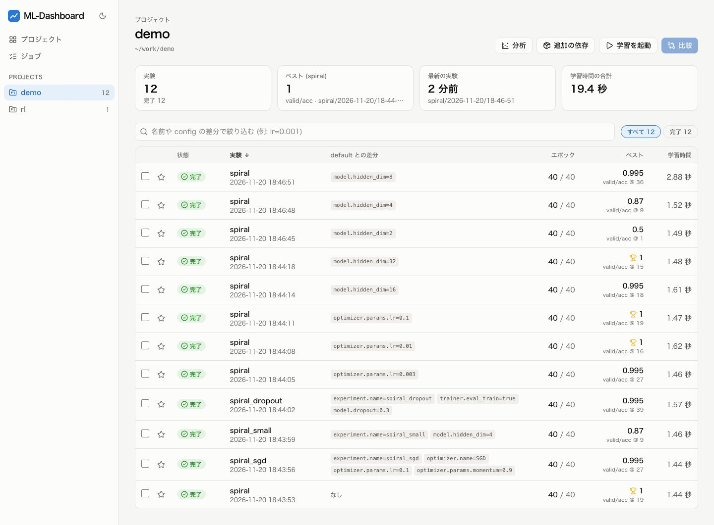
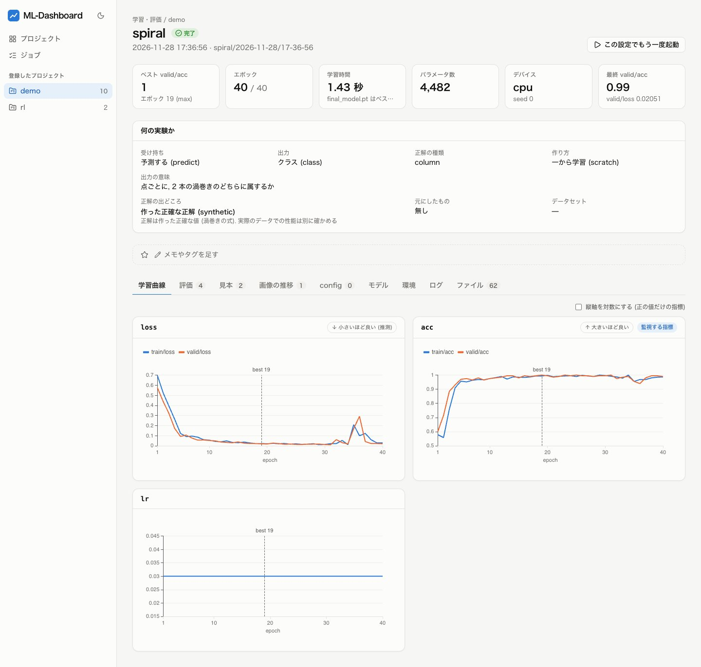
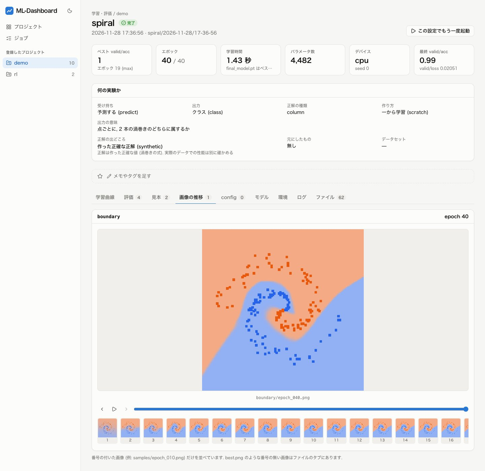
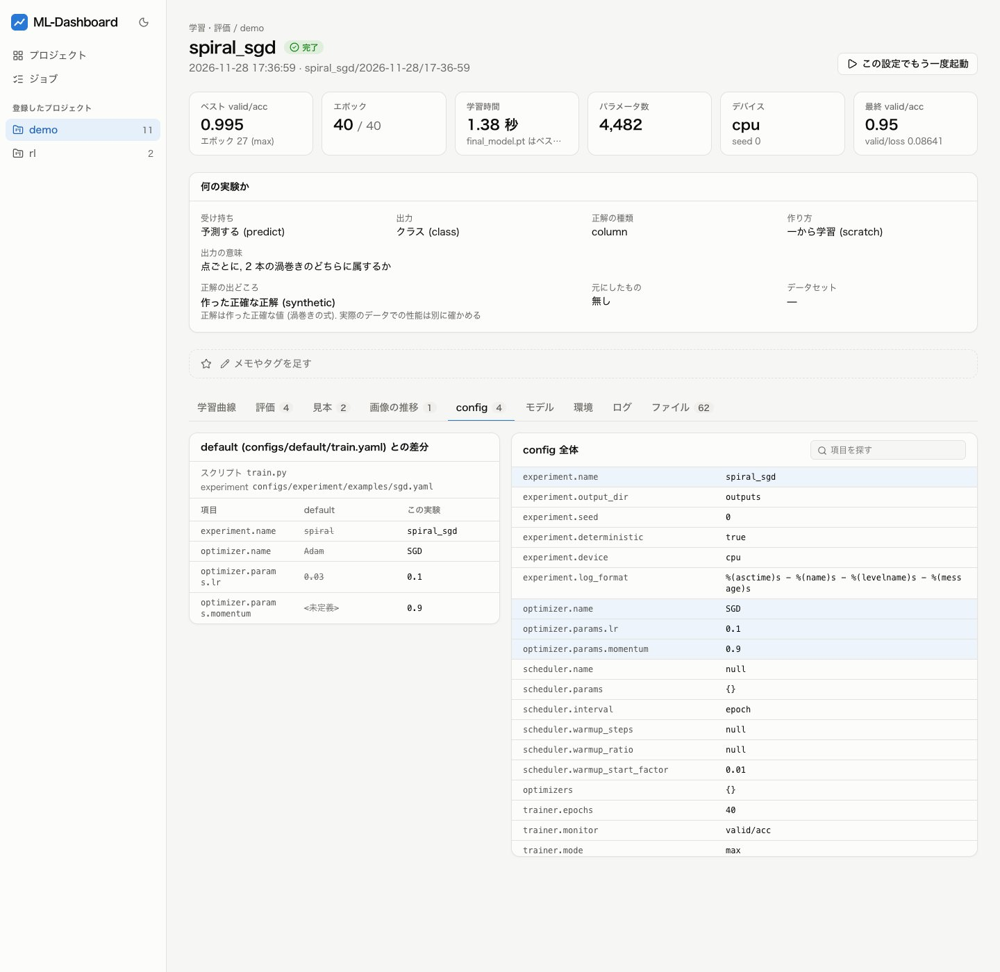
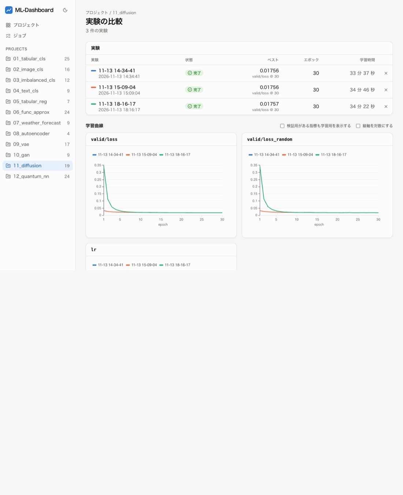
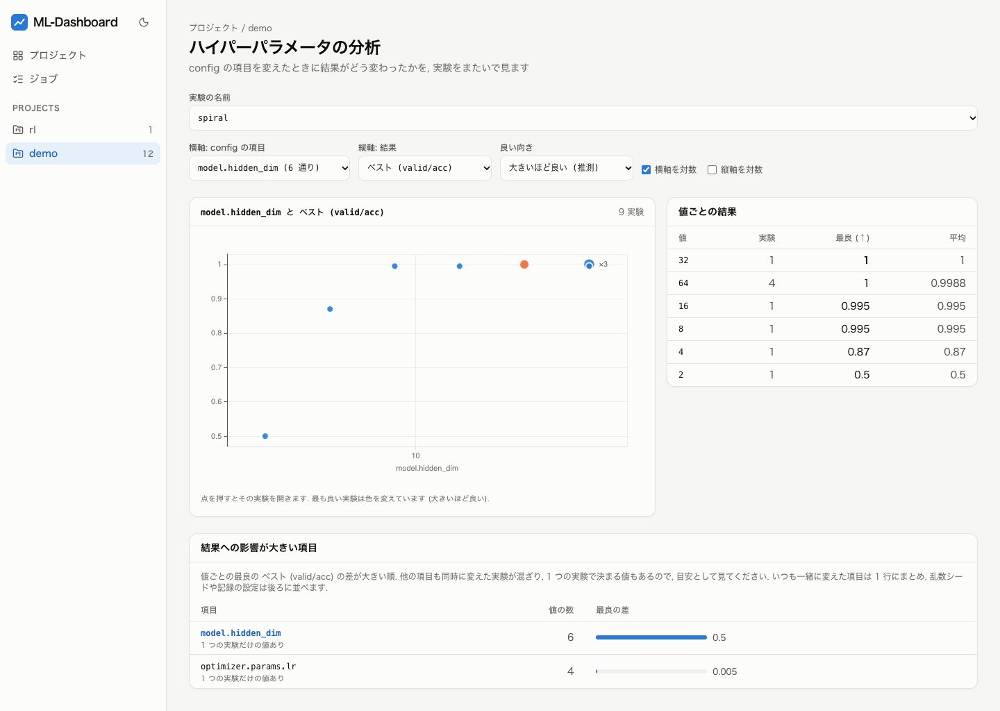
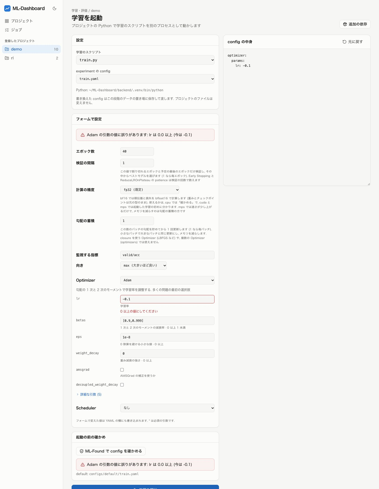
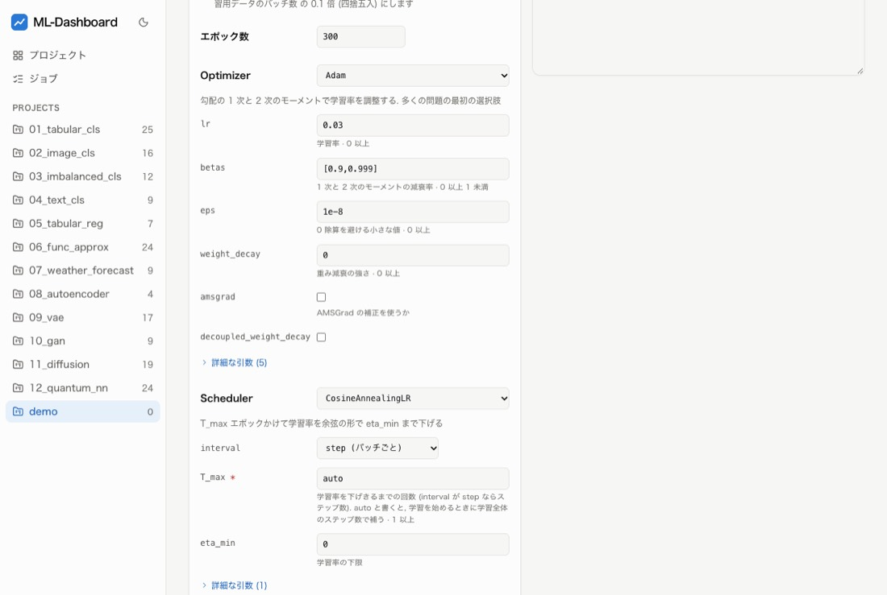
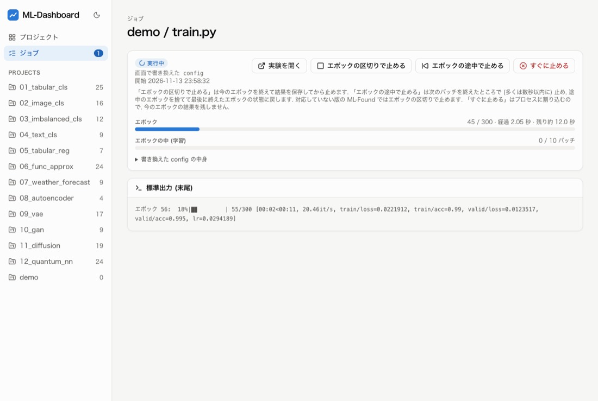
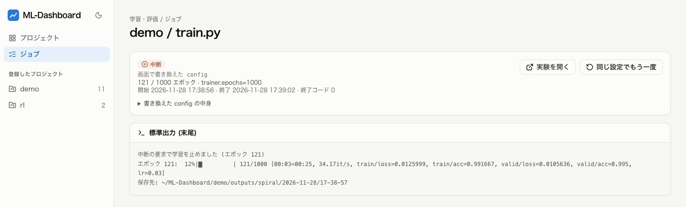

# ML-Dashboard 操作ガイド

ML-Dashboard の使い方を, 画面の順に説明する. 各章の「やってみる」は, ML-Dashboard に同梱した `demo` (2 本の渦巻きを分ける小さなモデル. CPU で数秒で学習する) だけで試せる. より多くの種類の学習で試す場合は, 10 章の ML_tester のタスクを使う.

## 目次

0. [準備](#準備)
1. [起動する](#1-起動する)
2. [プロジェクトを登録する](#2-プロジェクトを登録する)
3. [実験の一覧](#3-実験の一覧)
4. [実験の詳細](#4-実験の詳細)
5. [実験を比べる](#5-実験を比べる)
6. [ハイパーパラメータの分析](#6-ハイパーパラメータの分析)
7. [画面から学習を起動する](#7-画面から学習を起動する)
8. [進み具合を見て止める](#8-進み具合を見て止める)
9. [困ったとき](#9-困ったとき)
10. [ML_tester のタスクで試す](#10-ml_tester-のタスクで試す)

画面の図の多くは, `demo` に加えて ML_tester のタスク (10 章) を登録し, 多くの実験を流した環境で撮った. 実験の数や一覧の中身は, 手元とは違う.

## 準備

ML-Found の用語のうち, この手順書でよく使うもの.

- **default と experiment の config**: ML-Found のプロジェクトは, 基準の設定 `configs/default/train.yaml` と, そこから変えたい項目だけを書いた `configs/experiment/*.yaml` を持つ. 学習のときに 2 つを重ねる. ダッシュボードの「default との差分」は, 実験ごとに default から変わった項目
- **実験**: 1 回の学習で ML-Found が `outputs/<名前>/<日付>/<時刻>/` に残すディレクトリ (学習の記録 `history.csv`, config, ログ, モデルなど)

「やってみる」の前に, ML-Dashboard を README の「導入と起動」の手順で導入し, `make demo` で `demo` の実験を 4 つ作っておく (CPU で 1 つ数秒, 全部で十数秒). 作る実験は次の 4 つ.

| 実験の名前 | default との差分 | 見るもの |
| --- | --- | --- |
| `spiral` | なし | 基準 (Adam) |
| `spiral_sgd` | Optimizer を SGD (lr 0.1, momentum 0.9) に | Optimizer の違い |
| `spiral_small` | 隠れ層の大きさを 4 に | 表現力の不足 |
| `spiral_dropout` | Dropout を 0.3 にし, 学習用データを評価し直す (`trainer.eval_train`) | 学習中の値と評価し直した値の違い |

画面の「default との差分」には, 変えた実験の名前 (`experiment.name`) も並ぶ.

## 1. 起動する

ダッシュボードはローカルで動く Web アプリ. 端末で起動して, 表示された URL をブラウザで開く. 導入 (`make setup`) は [README](../README.md) の「導入と起動」を参照.

1. ML-Dashboard を clone したディレクトリで `make serve` を実行する. 画面をビルドしてから `http://127.0.0.1:8765` で待ち受ける. 端末は使ったままになるので, 止めるまでそのままにする
2. 端末に `ML-Dashboard を開く: http://127.0.0.1:8765/api/auth?token=…` と出るので, その URL を開く. トークンは起動するたびに変わる
3. 左に「プロジェクト」と「ジョブ」が並んだ画面が開けば準備完了. ロゴの横の月のアイコンで, 明るさを切り替えられる

```bash
make serve
```

> **トークンを毎回同じにする**
> `ML_DASHBOARD_TOKEN=好きな文字列 make serve` で起動すると, `http://127.0.0.1:8765/api/auth?token=好きな文字列` を開けば入れる. ブラウザを閉じるまでは, `http://127.0.0.1:8765` だけで開ける.


## 2. プロジェクトを登録する

プロジェクトは, ML-Found を使っているディレクトリ (`configs/default/train.yaml` を持つもの). 親のディレクトリを指定すると, まとめて登録できる.

1. 「プロジェクトを追加」を押す
2. パスの欄に, ML-Dashboard を clone したディレクトリの中の `demo` のパスを入れて (`~` から書ける. 例: `~/ML-Dashboard/demo`) 「探す」を押す
3. 選ばれた状態で「1 件を追加」を押すと, 左の「PROJECTS」に `demo` が並ぶ. 数字は実験の数

親のディレクトリを入れると, 3 階層下までのプロジェクトが並び, まとめて登録できる (`outputs` や `data`, submodule の中は探さない). 図は ML_tester (10 章) の 12 のタスクを探した例.


一度登録したプロジェクトは, ダッシュボードを起動し直しても残る.

> **ダッシュボードはプロジェクトに書き込まない**
> 登録の情報, メモ, タグ, 画面で書き換えた config は `~/.ml-dashboard/` (`ML_DASHBOARD_HOME` で変えられる) に保存する. プロジェクトのディレクトリには, 学習を止めるときの `STOP` のファイル以外は何も書かない.

## 3. 実験の一覧

左でプロジェクトを選ぶと, そのプロジェクトの実験が新しい順に並ぶ. `demo` を選ぶと, `make demo` で作った 4 つの実験が並ぶ.



- **上のカード**: 実験の数, ベストの実験, 最新の実験, 学習時間の合計
- **default との差分**: その実験で default の config から変えた項目. 実験を見分ける一番の手がかりになる
- **絞り込みと並べ替え**: 状態 (「すべて」「完了」など) と, 差分の文字で絞り込む. 見出しを押すと並べ替える
- **星とタグ**: 星は一覧の行の星のアイコンか, 実験の詳細の星のボタンで付ける. タグとメモは実験の詳細の「メモやタグを追加」から付ける. 一覧で星とタグで絞り込める
- **右上のボタン**: 「分析」「学習を起動」「比較」

## 4. 実験の詳細

一覧で実験を押すと詳細が開く. 上にベストの値, エポック, 学習時間, パラメータ数, デバイス, 最終の値が並び, その下のタブで中身を見る.



| タブ | 見るもの |
| --- | --- |
| 学習曲線 | 指標ごとに学習用と検証用を重ねたグラフ. `train_eval/` (学習用データを推論モードで評価し直した値) があれば 3 本目として重なる. 「監視する指標」の印とベストのエポックの縦線が付く. 拡大と対数の縦軸. step ごとに学習率を変えた実験は, 学習率のグラフにエポックの中の変化も重なる |
| 画像の推移 | `samples/epoch_010.png` のように番号の付いた画像を, スライダーと再生で順に見る (生成モデルのサンプルなど) |
| config | default との差分と, config 全体 (検索できる). ML-Found が補った値 (`auto` や warmup の回数) もここに出る |
| モデル | モデルの構造, Optimizer, Scheduler と, パラメータの一覧 (名前, 層, 形, 要素数, 学習するか, 重みの共有). 名前付きの Optimizer (`optimizers`) の実験では, 名前ごとの Optimizer, 受け持つ部分, Scheduler の表も出る. パラメータの一覧は, 古い版の ML-Found で流した実験には出ない. その場合は流し直す |
| 環境 | プロジェクトと ML-Found の git の情報, OS, PyTorch, パッケージ, 学習時の未コミットの変更 |
| ログ | `train.log` を警告とエラーで絞り込み, 検索する |
| ファイル | 実験のディレクトリのファイルの一覧. 画像は押すと大きく表示し (多い場合は 48 枚ずつ並べる), テキスト (YAML, ログ, CSV など) は新しいタブで開ける. 全てのファイルをダウンロードできる |

<table>
  <tr>
    <td></td>
    <td></td>
  </tr>
  <tr>
    <td>画像の推移 (ML_tester の 11_diffusion の例). スライダーでエポック 10, 20, 30 の生成画像を見比べる</td>
    <td>config (ML_tester の 11_diffusion の例). この実験は default から <code>ema.eval</code> だけを変えている</td>
  </tr>
</table>

### やってみる 1: 学習用データの評価し直しを見る (3 分)

- [ ] `demo` を開き, `spiral_dropout` の実験 (差分が `experiment.name=spiral_dropout`, `model.dropout=0.3`, `trainer.eval_train=true`) を開く
- [ ] 学習曲線の `acc` で, `train/acc`, `train_eval/acc`, `valid/acc` の 3 本を見比べる
- [ ] 「モデル」のタブで, モデルの構造 (`Dropout` の層), Optimizer, パラメータの一覧と要素数の合計を見る

**見どころ**: 学習中の値 (`train/acc`) は Dropout が効いた状態の予測なので, 推論モードで評価し直した値 (`train_eval/acc`) より低く出やすい (この例では最後のエポックで 0.96 と 0.97). 評価し直した値と検証用の値を比べると, 過学習しているかどうかが分かる (この例ではほぼ重なり, 過学習していない).

### やってみる 2: 決定境界の移り変わりを見る (2 分)

- [ ] `spiral` の実験 (差分が `なし`) を開き, 「画像の推移」のタブを開く
- [ ] 開いたときは最後のエポック (40) の画像が出る. 再生を押すと, エポック 1 から 40 までの決定境界の画像を順に見られる (スライダーでも動かせる)

**見どころ**: `demo` の学習は, 検証のたびに `boundary/epoch_001.png` のように決定境界の画像を保存する. 最初は直線に近い境界が, エポックが進むと 2 本の渦巻きに沿って曲がっていく. 番号の付いた画像を保存するだけで, 学習のコードに他の処理を足さなくても見られる.

## 5. 実験を比べる

一覧で 2 つ以上の実験の行のチェックを入れ, 上の「比較 (n)」を押す. 8 つまで選べる. 図は ML_tester の 11 (拡散モデル) の 3 つの実験を比べた例.



学習曲線は指標ごとに実験を重ね, 同じエポックの画像 (生成画像や決定境界など) を横に並べ, config の違う項目だけを表にする.

- 検証用がある指標は, 既定では検証用だけを出す. 「検証用がある指標も学習用を表示する」で学習用も出る
- 全てのエポックで同じ値の実験は線が完全に重なり, 下の線が見えなくなるので, グラフの下に「線が重なっています」と実験の名前を出す
- config の違いの表の `—` は, その実験の config にその項目が無いことを表す (Optimizer を変えて引数の種類が違う場合 (Adam には `momentum` が無いなど) や, 古い版の ML-Found で流した場合)

### やってみる 3: Optimizer とモデルの大きさの違いを比べる (5 分)

- [ ] `demo` の一覧で, `spiral`, `spiral_sgd`, `spiral_small` の 3 つにチェックを入れて「比較 (3)」を押す
- [ ] `valid/acc` のグラフで, 隠れ層を 4 にした `spiral_small` だけが低いところで止まることを見る
- [ ] `lr` のグラフでは, どちらも 0.03 のままの `spiral` と `spiral_small` の線が重なり, グラフの下に「線が重なっている実験」と出ることを見る
- [ ] config の違いの表で, 3 つの実験の違う項目 (`optimizer.name`, `model.hidden_dim` など) だけが並ぶことを見る. Adam の `spiral` には `momentum` が無いので `—` になる
- [ ] 画像の比較で, エポック 40 の決定境界を 3 つ並べて見る (`spiral_small` は渦巻きに沿って曲がりきらない)

## 6. ハイパーパラメータの分析

一覧の「分析」から開く. **同じ名前の実験の中で**値を変えた config の項目と, 結果 (ベストや最後の指標) の関係を散布図と値ごとの表で見る. 値を変えた実験が多いほど役に立つ. `make demo` の 4 つの実験は名前が全て違うので, そのままでは比べる項目が出ない (下の「やってみる」で, 同じ名前の実験を足す).



- 横軸に config の項目, 縦軸に結果を選ぶ. 点を押すとその実験が開く
- 下の「結果への影響が大きい項目」は, 値ごとの最良の差が大きい順 (`一部の実験だけ` と `記録や環境` の項目は後ろに回す). 他の項目も同時に変えた実験が混ざるので目安
- 項目の横の `一部の実験だけ` は, その項目を持たない実験があることを表す (Optimizer の種類で引数が違う場合や, 古い版の ML-Found で流したもの). `記録や環境` は結果に関係しない設定 (デバイス, 保存の設定など)

### やってみる 4: 学習率と隠れ層の大きさの影響を見る (3 分)

- [ ] ML-Dashboard を clone したディレクトリで, 次の 2 つを流し, `spiral` の名前の実験を足す (それぞれ数秒). 7 章の画面から, フォームで値を変えて起動してもよい

```bash
cd backend
uv run python ../demo/train.py optimizer.params.lr=0.003
uv run python ../demo/train.py model.hidden_dim=16
```

- [ ] `demo` の一覧の「分析」を開き, 実験の名前に `spiral` を選ぶ
- [ ] `optimizer.params.lr` と `model.hidden_dim` が 2 通りずつ並び, 散布図と値ごとの表, 「結果への影響が大きい項目」が出ることを見る

## 7. 画面から学習を起動する

一覧の「学習を起動」から開く. 学習のスクリプトと experiment の config を選び, フォームか YAML の欄で書き換えてから, ML-Found で確かめて起動する.


1. **学習のスクリプト** と **experiment の config** を選ぶ. 学習は, プロジェクトの Python (登録したときに, プロジェクトのディレクトリから上に向かって探して見つかった仮想環境. 見つからなければダッシュボード自身の Python で, `demo` はこれ) で別のプロセスとして動く
2. **フォーム** でエポック数, Optimizer と Scheduler とその引数を変える. 引数には ML-Found の登録簿の説明と範囲が付き, `*` は必須. 数の欄には `auto` とも書ける (学習全体のステップ数で補う引数だけ). フォームで変えた値は YAML の欄にも書き込まれる
3. フォームに無い項目 (warmup, `trainer.eval_train` など) は, 右の YAML の欄に直接書く
4. 「ML-Found で config を確かめる」を押す. 結果は 3 種類で出る
    - **誤り**: このままでは起動できないもの (存在しない項目, 範囲の外の値, 作れない Optimizer など). 値の誤りはフォームの該当する欄にも出る
    - **注意**: 起動はできるが確かめたいもの (学習率が下がりきらない, 名前の最後の語が `path`, `dir`, `file` の項目 (`train_path` など) のファイルが無い, など. 相対パスはプロジェクトのディレクトリから辿る)
    - **お知らせ**: ML-Found が学習を始めるときに補う値 (`auto`, warmup の回数など)
5. 誤りが無ければ「学習を開始」を押す. ジョブの画面に移る. 画面で書き換えた config はダッシュボードの置き場に保存して渡すので, プロジェクトの config のファイルは変わらない

<table>
  <tr>
    <td></td>
    <td></td>
  </tr>
  <tr>
    <td>誤りの例 (<code>demo</code>). YAML の欄に <code>lr: -0.1</code> を書いて確かめると「lr は 0.0 以上 (今は -0.1)」と出て, フォームの lr の欄も赤くなる</td>
    <td><code>T_max: auto</code> と <code>warmup_ratio: 0.1</code> を書いた例 (<code>demo</code>). フォームにも <code>auto</code> が出る. 確かめると, 補う値がフォームの上のお知らせに出る</td>
  </tr>
</table>

> **GPU を使う学習は 1 つずつ**
> 画面から起動した学習も, config で GPU を選んでいれば, 端末から流す学習と同じく GPU を使う. 重い学習を同時に 2 つ動かすと, どちらも遅くなる. 試すときは, CPU で数秒で終わる `demo` が手軽.

### 実験の設定でもう一度起動する

実験の詳細の右上の「この設定でもう一度起動」を押すと, その実験と同じスクリプトと experiment の config を選んだ状態で, この画面が開く. ML-Found が実験に残す起動のしかた (`source.yaml`) を使う.

- コマンドラインで `trainer.epochs=10` のような上書きを付けて流した実験は, 上書きを YAML の欄に重ねた状態 (書き換えた状態) で開く. 「元に戻す」で config のファイルの中身に戻る
- 画面で config を書き換えて起動した学習の実験は, そのとき渡した config の中身が「実験 … の config」として選ばれる
- 起動の前の確認は, 実験が元にした default の config で行う (スクリプトを選び直すと, いつもどおりスクリプトから選ぶ)
- config のファイルを実験の後に書き換えた場合は, 今の中身が入る. その場合は画面の上にお知らせが出る
- `source.yaml` の無い古い実験, スクリプトや config のファイルが無くなった実験では, ボタンを押せず, 理由が出る

### やってみる 5: 確かめる, 起動する (5 分)

- [ ] `demo` で「学習を起動」を開く (config は `train.yaml` のまま. 右の YAML の欄の中身は空の設定を表す `{}` だけ)
- [ ] フォームの lr を `-0.1` にして欄から出ると, 欄の下に誤りが出ることを見る. 誤りがある間は YAML の欄に書き込まない. 見たら lr を `0.03` に戻す
- [ ] YAML の欄を空にして次の 1 つ目を書き, 「ML-Found で config を確かめる」を押し, 上に出る誤りと, フォームの lr の欄の赤い表示を見る. 見たら「元に戻す」で YAML を最初に戻す (誤りが残っていると起動できない)
- [ ] もう一度 YAML の欄を空にして次の 2 つ目を書いて確かめ, `T_max` と warmup の回数のお知らせを見る
- [ ] 「学習を開始」を押し, 終わったら「実験を開く」から学習率のグラフ (最初の 1 割で上がってから, 余弦の形で下がる) を見る

```yaml
optimizer:
  params:
    lr: -0.1
```

```yaml
scheduler:
  name: CosineAnnealingLR
  interval: step
  params:
    T_max: auto
  warmup_ratio: 0.1
```

## 8. 進み具合を見て止める

ジョブの画面と実験の一覧は数秒ごとに読み直すので, 学習の標準出力より少し遅れて表示が変わる (終わった直後も数秒は「実行中」のまま).

画面から起動した学習は「ジョブ」に並ぶ. エポックとバッチの進捗バー, 残り時間の目安, 標準出力の末尾が見られ, 止め方を 3 つから選べる.



学習中の実験は, 一覧と学習曲線も自動で更新される.

| ボタン | 止まり方 | 残るもの |
| --- | --- | --- |
| エポックの区切りで止める | 今のエポックを終えてから止める | そのエポックまでの記録と `last.pt`. 状態は「中断」. `last.pt` から再開できる |
| エポックの途中で止める | 次のバッチを終えたところ (多くは数秒以内) で止め, 途中のエポックを捨てる | 最後に終えたエポックの状態 (重み, Optimizer, Scheduler, 乱数) に戻して結果を保存する |
| すぐに止める | プロセスに割り込む (Ctrl-C と同じ) | 今のエポックの結果は残らない. 状態は「中断」 |



### やってみる 6: 3 つの止め方を試す (5 分)

- [ ] `demo` で「学習を起動」を開き, エポック数を `1000` にして起動する (CPU で 30 秒ほど). ジョブの画面で, 途中で「エポックの区切りで止める」を押す. 実験の一覧で状態が「中断」になることを見る
- [ ] もう一度エポック数を `1000` にして起動し, 「エポックの途中で止める」を押す (確認が出たら OK). 実験の「ログ」に「中断の要求で学習を止めました」と出ることを見る. デモの学習は 1 エポックがとても短い (数十ミリ秒) ので, 多くはエポックの区切りが先に来て, 区切りで止めた場合と同じ結果になる. 1 エポックが長い学習で押すと, 途中のエポックを捨てて「状態はエポック … のものに戻しました」と出る
- [ ] もう一度起動して「すぐに止める」を押し, 標準出力の末尾を見る

## 9. 困ったとき

| 症状 | 対処 |
| --- | --- |
| 画面を開いても一覧が出ない, 読み込めない | トークン付きの URL (`/api/auth?token=…`) を開き直す. 起動し直すとトークンが変わる |
| ポート 8765 が使われている | `make serve PORT=8800` のように別のポートで起動する |
| ダッシュボードを止めたい | `make serve` を動かしている端末で Ctrl-C を押す. 画面から起動した学習は, 先にジョブの画面で止めておく |
| 実験の一覧に新しい実験が出ない | ブラウザを再読み込みする. 学習中の実験は自動で更新される |
| 登録したプロジェクトを外したい | 「プロジェクト」の画面で, カードの「登録を外す」のボタンを押す. 実験のファイルは消えない |

## 10. ML_tester のタスクで試す

[ML_tester](https://github.com/victor-von-pooh/ML_tester) は, ML-Found を使った 12 の学習の例 (表形式の分類, 画像, グラフ, 拡散モデル, 量子回路など) を持つ動作確認の場. `demo` より多くの種類の学習で画面を試したい場合に使える. ダッシュボードを使うのに ML_tester は要らない.

1. ML_tester を, その README の「導入」の手順で導入する (`.venv` を作り, 依存を入れる). `.venv` は, ダッシュボードにプロジェクトを登録する**前**に作っておく. 登録したときに見つかった仮想環境の Python が, 画面から起動する学習に使われる
2. ML_tester の root で `.venv` を有効にして, 下の表の実験を流す
3. 2 章の手順で, ML_tester を clone したディレクトリを入れて「探す」を押し, 「12 件を追加」で登録する

流す実験.

| 試すこと | コマンド | 時間 |
| --- | --- | --- |
| 学習用データの評価し直し (4 章) | `python tasks/03_imbalanced_cls/train.py --experiment configs/experiment/examples/eval_train.yaml` | 数秒 |
| 外部ライブラリの層の重み (4 章) | `python tasks/12_quantum_nn/train.py` | 約 2 分 (CPU) |
| EMA で検証した効果の比較 (5 章) | `python tasks/11_diffusion/train.py` と, `--experiment configs/experiment/examples/no_ema.yaml`, `--experiment configs/experiment/examples/ema_eval.yaml` を付けたもの | それぞれ約 35 分 (GPU) |

時間は Apple Silicon の Mac で 1 つずつ流した場合の目安. 11 は GPU (CUDA か Apple Silicon の mps) が無いと, かなり長くかかる. 02 と 08 から 11 は, 最初の学習で MNIST などのデータを取得するのでネットワークが要る.

- **外部ライブラリの層の重み**: `12_quantum_nn` の default の実験の「モデル」のタブで, モデルの構造では `TorchConnector()` としか出ない層が, パラメータの一覧では重み 6 個として出る. 2 行目に「qnn.qnn_est.weight と共有」と出て, 同じ重みを 2 つの名前で持っているので, 学習するパラメータ数は 6 (2 回は数えない)
- **EMA で検証した効果**: `11_diffusion` の 3 つの実験 (差分が `なし`, `ema.use=false`, `ema.eval=true`) を比べると, `valid/loss` のグラフで, EMA の重みで検証した実験は最初が高く, その後はなめらかに下がる (縦軸を対数にすると分かりやすい). default は EMA を生成画像にだけ使い, 検証は学習中の重みで行うので, `ema.use=false` と線が重なる
