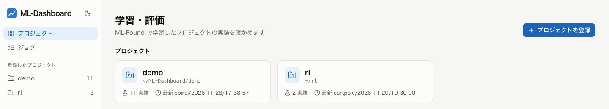
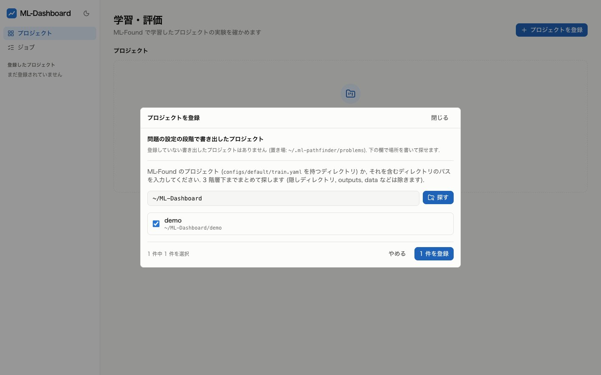
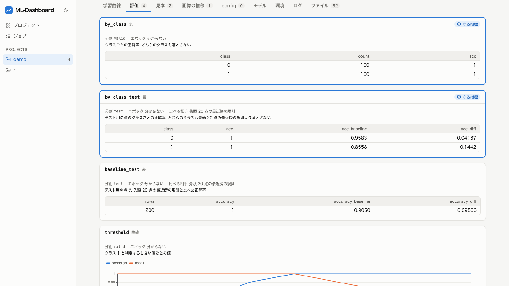
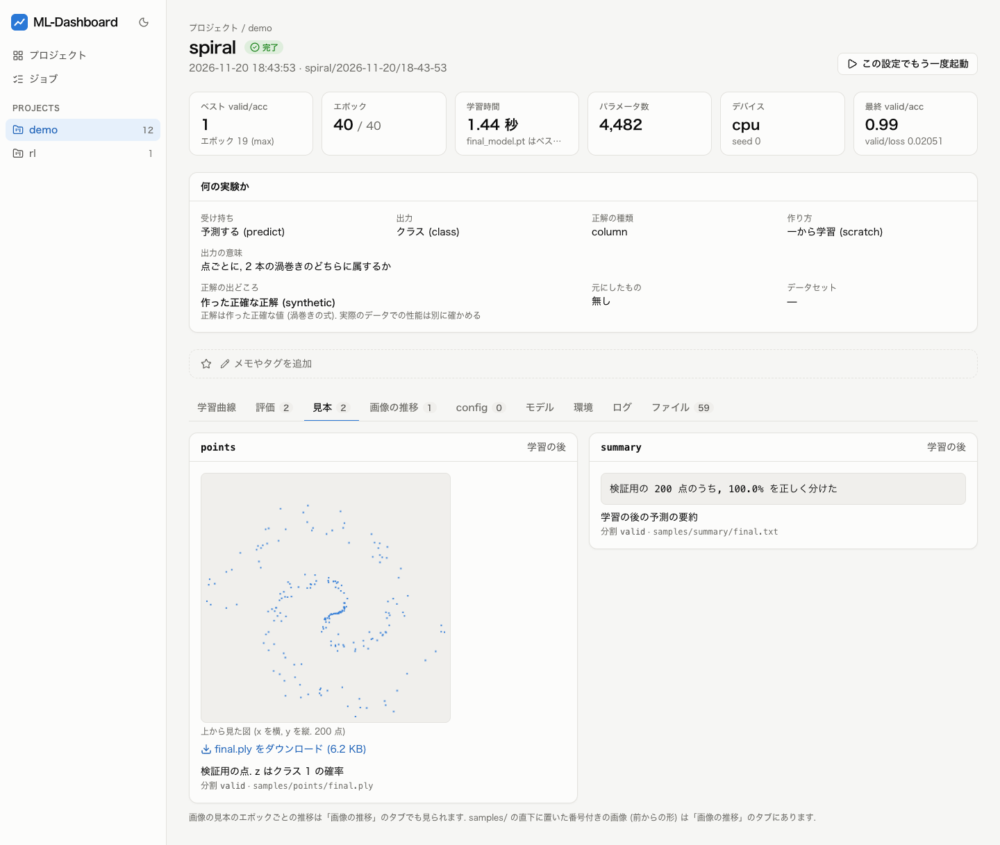
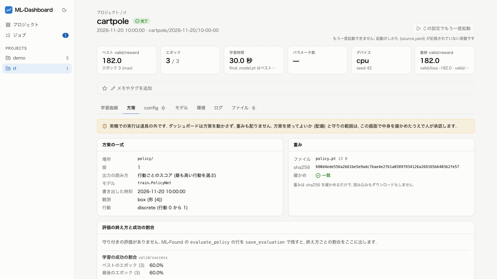
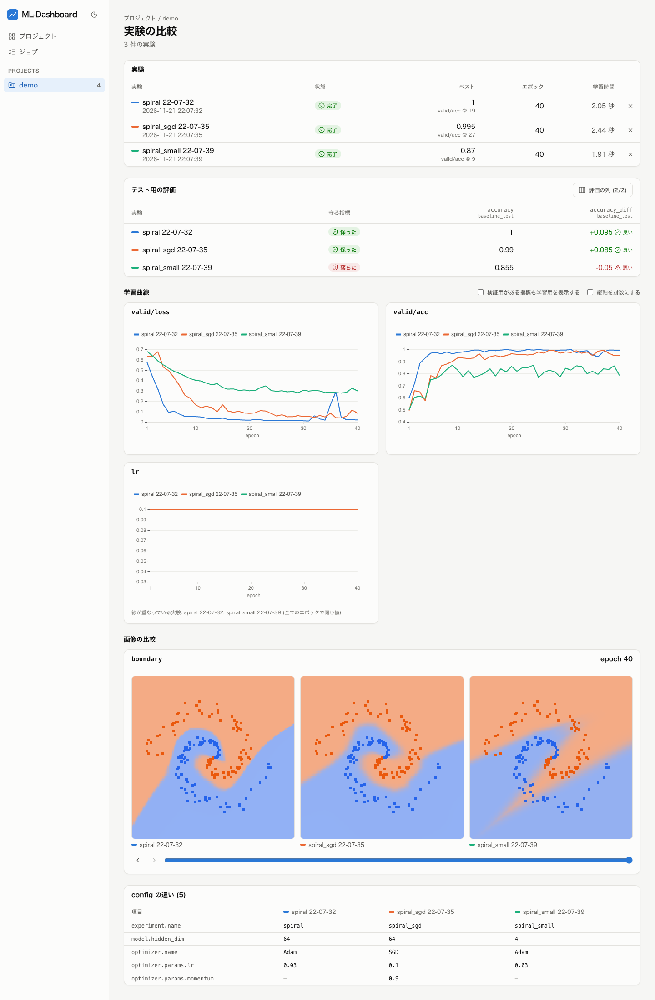
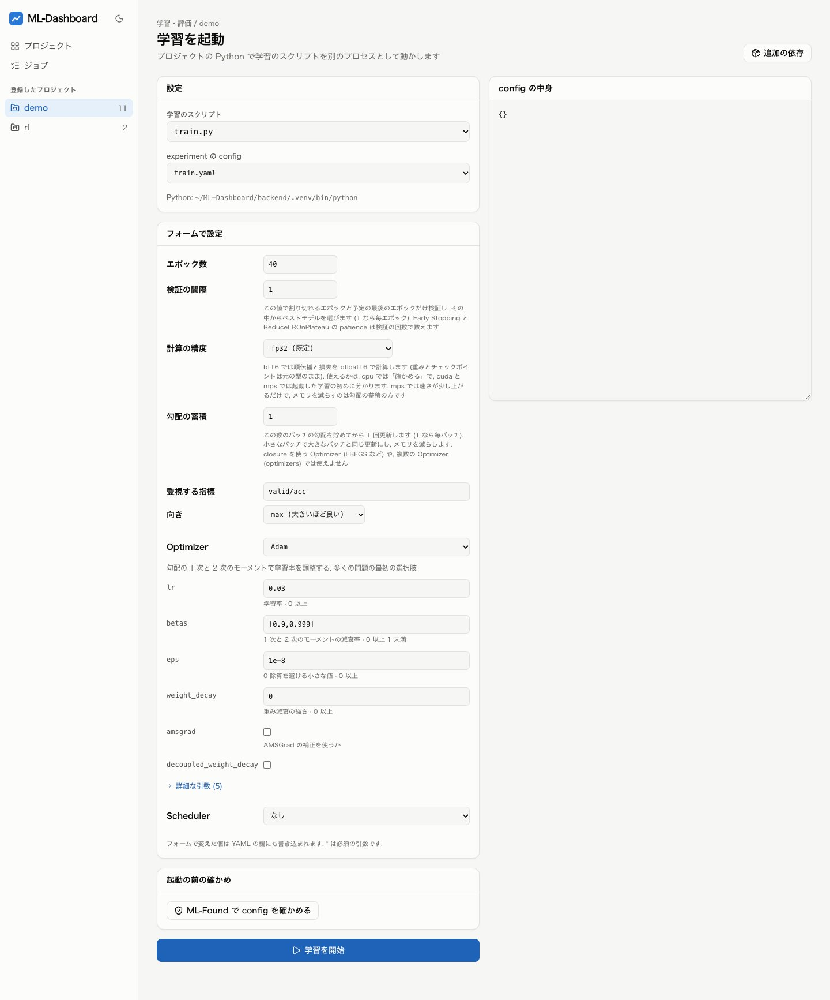

# ML-Dashboard 操作ガイド

ML-Dashboard の使い方を, 画面の順に説明する. 各章の「やってみる」は, ML-Dashboard に同梱した `demo` (2 本の渦巻きを分ける小さなモデル. CPU で数秒で学習する) だけで試せる. より多くの種類の学習で試す場合は, 9 章の ML_tester のタスクを使う.

## 目次

0. [準備](#準備)
1. [起動する](#1-起動する)
2. [プロジェクトを登録する](#2-プロジェクトを登録する)
3. [実験の一覧](#3-実験の一覧)
4. [実験の詳細](#4-実験の詳細)
5. [実験を比べる](#5-実験を比べる)
6. [ハイパーパラメータの分析](#6-ハイパーパラメータの分析)
7. [画面から学習を起動する](#7-画面から学習を起動する)
8. [進み具合を見て止める](#8-進み具合を見て止める)
9. [ML_tester のタスクで試す (任意)](#9-ml_tester-のタスクで試す-任意)
10. [困ったとき](#10-困ったとき)

画面の図は `demo` の実験で, `images/` の直下の図 (方策と追加の依存の図を除く) と実験の一覧の図は `make demo` の 4 つ (`make screenshots` で撮る. 実行中のジョブの図は, それに長い学習を 1 つ足したもの), 他の図はそれに 6 章の「やってみる」のように学習率と隠れ層の大きさを変えた `spiral` の実験をいくつか足したもの. 方策と追加の依存の図は, 画面の通しのテストに置いた強化学習の実験 (`frontend/e2e/fixtures/rl/`) を `rl` として登録したもの.

## 準備

ML-Found の用語のうち, この手順書でよく使うもの.

- **default と experiment の config**: ML-Found のプロジェクトは, 基準の設定 `configs/default/train.yaml` と, そこから変えたい項目だけを書いた `configs/experiment/*.yaml` を持つ. 学習のときに 2 つを重ねる. ダッシュボードの「default との差分」は, 実験ごとに default から変わった項目
- **実験**: 1 回の学習で ML-Found が `outputs/<名前>/<日付>/<時刻>/` に残すディレクトリ (学習の記録 `history.csv`, config, ログ, モデルなど)

「やってみる」の前に, ML-Dashboard を README の「導入と起動」の手順で導入し, `make demo` で `demo` の実験を 4 つ作っておく (CPU で 1 つ数秒, 全部で十数秒). 作る実験は次の 4 つ.

| 実験の名前 | default との差分 | 見るもの |
| --- | --- | --- |
| `spiral` | なし | 基準 (Adam) |
| `spiral_sgd` | Optimizer を SGD (lr 0.1, momentum 0.9) に | Optimizer の違い |
| `spiral_small` | 隠れ層の大きさを 4 に | 表現力の不足 |
| `spiral_dropout` | Dropout を 0.3 にし, 学習用データを評価し直す (`trainer.eval_train`) | 学習中の値と評価し直した値の違い |

画面の「default との差分」には, 変えた実験の名前 (`experiment.name`) も並ぶ. `make demo` を実行するたびに実験が 4 つずつ増える. 消す場合は `demo/outputs/` を削除する.

## 1. 起動する

ダッシュボードはローカルで動く Web アプリ. 端末で起動して, 表示された URL をブラウザで開く. 導入 (`make setup`) は [README](../README.md) の「導入と起動」を参照.

1. ML-Dashboard を clone したディレクトリで `make serve` を実行する. 画面をビルドしてから `http://127.0.0.1:8765` で待ち受ける. 端末は使ったままになるので, 止めるまでそのままにする
2. 端末に `ML-Dashboard を開く: http://127.0.0.1:8765/api/auth?token=…` と出るので, その URL を開く. トークンは起動するたびに変わる
3. 左に「プロジェクト」と「ジョブ」が並んだ画面が開けば準備完了. ロゴの横の月のアイコンで, 明るさを切り替えられる

```bash
make serve
```

> **トークンを毎回同じにする**
> `ML_DASHBOARD_TOKEN=好きな文字列 make serve` で起動すると, `http://127.0.0.1:8765/api/auth?token=好きな文字列` を開けば入れる. ブラウザを閉じるまでは, `http://127.0.0.1:8765` だけで開ける.

> **起動の設定**
> - ポートは `make serve PORT=8800` のように変える. ビルド済みの場合は `cd backend && uv run ml-dashboard --port 8800` でも起動できる
> - 既定では `127.0.0.1` だけで待ち受ける. `--host` で変えられるが, トークンを知る人は学習のコードを実行できるので勧めない
> - 登録したプロジェクト, 画面で書き換えた config, 起動した学習の標準出力, メモとタグは `~/.ml-dashboard/` に保存する. 場所は環境変数 `ML_DASHBOARD_HOME` で変える. 全て消す場合は, ダッシュボードを止めてからこのディレクトリを削除する
> - ダッシュボードを止めても, 画面から起動した学習は別のプロセスなので続く. 学習も止める場合は, 先にジョブの画面で止める



## 2. プロジェクトを登録する

プロジェクトは, ML-Found を使っているディレクトリ (`configs/default/train.yaml` を持つもの). 親のディレクトリを指定すると, まとめて登録できる.

ML-Pathfinder で学習のプロジェクトを書き出した場合は, 「プロジェクトを追加」の先頭の「ML-Pathfinder で書き出したプロジェクト」に, まだ登録していないものが並ぶ. 「登録」を押すだけで登録できる (場所を打たなくてよい). 一覧は ML-Pathfinder の置き場 (環境変数 `ML_PATHFINDER_HOME`. 無ければ `~/.ml-pathfinder`) の問題の設定を読む. 同梱の `demo` などは, 次の手順で場所を入れて登録する.

1. 「プロジェクトを追加」を押す
2. パスの欄に, ML-Dashboard を clone したディレクトリの中の `demo` のパスを入れて (`~` から書ける. 例: `~/ML-Dashboard/demo`) 「探す」を押す
3. 選ばれた状態で「1 件を追加」を押すと, 左の「PROJECTS」に `demo` が並ぶ. 数字は実験の数

親のディレクトリを入れると, 3 階層下までのプロジェクトが並び, まとめて登録できる (隠しディレクトリ, `outputs`, `data`, `node_modules` など, git の submodule の中は探さない. submodule の中のプロジェクトは, そのディレクトリを直接入れれば探せる). 登録済みのものには「登録済み」と出る.



一度登録したプロジェクトは, ダッシュボードを起動し直しても残る.

> **自分のプロジェクトを使う**
> ML-Found のプロジェクトの作り方 (`configs/default/train.yaml`, `configs/experiment/train.yaml`, 学習スクリプト) は, ML-Found の README の [使い方](https://github.com/victor-von-pooh/ML-Found#使い方) にある. 小さな雛形として `demo/` (`train.py` と `configs/`) を写して始めてもよい.
> 画面から起動する学習には, 登録したときに見つかった仮想環境の Python を使う. プロジェクトに関係する仮想環境だけを探す. プロジェクトが git のリポジトリの中にあれば, プロジェクトのディレクトリからリポジトリのルートまで上に向かって (近い方から), 無ければプロジェクトのディレクトリだけで, `.venv` か `venv` の `bin/python` を探す. ホームは探さず, `.git` の無い場所 (git のリポジトリの外) のプロジェクトでは上の階層の仮想環境を拾わない. 見つからない場合は, 下の「学習の準備」のカードからプロジェクトの `.venv` を作れる (作り終えると, 学習にその `.venv` を使う).

> **ダッシュボードはプロジェクトにほとんど書き込まない**
> 登録の情報, メモ, タグ, 画面で書き換えた config は `~/.ml-dashboard/` (`ML_DASHBOARD_HOME` で変えられる) に保存する. プロジェクトのディレクトリには, 学習を止めるときの `STOP` のファイルと, 「学習の準備」で利用者が始めたときの `.venv` 以外は何も書かない.

### 学習の準備

プロジェクトを選ぶと, 画面の先頭に「学習の準備」のカードが出る. default の config (`configs/default/train.yaml`) から, 学習に要るものがそろっているかを確かめる.

- **データセット**: `data.dataset` に書いた場所にあるか. 無ければ, データの分析 (ML-Fathom) で書き出す場所を出す
- **モデルの定義**: `model.spec` を書いた場合だけ, その場所にあるか. 無ければ, モデルの作成 (ML-CreateArchitecture) で置く. 画像と領域, 撮影と点群のプロジェクト (問題の設定の ML-Quest が書き出したもの) は, 置くまでは学習のスクリプトの仮のモデルで学習できるので, 無いことを知らせるだけで準備は止めない
- **学習の環境**: プロジェクトの `.venv` があり, ML-Found と config の `requires` に書いた機能 (例: `requires: [eda, modelcontrol, inference]`) が入っているか

足りなければ「環境を作る」(`.venv` が無い場合) か「足りないものを入れる」のボタンが出る. 押すと動かすコマンド (`.venv` を作るコマンドと, `pip install` のコマンド) が出るので, 確かめて「実行する」を押す. パッケージはネットワークから取るので, 初めては PyTorch などで数分かかる. 出力はカードの下に出る. 終わると, そのプロジェクトの学習に `.venv` の Python を使う. uv が入っていれば uv で作って入れ, 無ければ Python の venv と pip を使う.

ROS 2 と CUDA のように pip で入らない機能は, 公式の手順へのリンクを出す.

## 3. 実験の一覧

左でプロジェクトを選ぶと, そのプロジェクトの実験が新しい順に並ぶ. `demo` を選ぶと, `make demo` で作った 4 つの実験が並ぶ.

図はプロジェクトの名前と「学習の準備」のカードより下の部分.


- **上のカード**: 実験の数, ベストの実験, 最新の実験, 学習時間の合計
- **default との差分**: その実験で default の config から変えた項目. 実験を見分ける一番の手がかりになる
- **絞り込みと並べ替え**: 状態 (「すべて」「完了」など) と, 差分の文字で絞り込む. 見出しを押すと並べ替える (評価の値と守る指標でも絞り込める. 下の 2 つの項)
- **テスト用の評価**: ML-Found の `evaluations/` にテスト用 (`split: test`) の評価がある実験では, 1 行の表の値が列に並ぶ (比べる相手との表は `<指標>` と差の `<指標>_diff`). 差は, 指標の向きが分かれば「良い」(緑と丸の印) か「悪い」(赤と三角の印) を添える. 向きは評価に書いた `better` (ML-Found の `save_evaluation` の引数) を先に使い, 書いていない列だけを指標の名前から推し量る. 名前から向きの決まらない指標 (`neg_log_loss`, 独自の指標など) は, 評価を書くときに `better` を添えると色と印が付く. 列は 3 つまでで, 「評価の列」で選び替える. 列の見出しで並べ替え (初めは良い順), 検索の欄に `accuracy>=0.9` や `baseline_test:accuracy_diff<0` のように書くと値で絞り込む
- **守る指標**: テスト用の守る指標の表 (`guard`) を持つ実験に, 比べる相手より「落ちた」「保った」「判断できない」(向きが分からない, 差の列が無いなど. 向きが分からない場合は評価に `better` を書く) の印が付く. 印を押すと (キーボードでは Tab で選んで Enter, タッチでは触ると) 印の下に落ちた指標と差 (判断できない場合はその理由) が浮いて開き (窓の下端では印の上), もう一度押すか, Esc か外を押すと閉じる. Tab で印から離れても (説明の文を押した後も), 他の印を開いても閉じる. 上の「守る指標:」の印で絞り込める
- **モデルの定義**: config の `model.spec` でモデルの定義を選ぶプロジェクトでは, 実験が学習に使った定義の名前 (`models/` からの場所から拡張子を除いたもの. `models/resnet_small.yaml` なら `resnet_small`) の列が出る. 写しから起動し直した実験も, 元の定義の名前になる (元の実験を消すと「写し」). 検索の欄に定義の名前を書いても絞り込める
- **星とタグ**: 星は一覧の行の星のアイコンか, 実験の詳細の星のボタンで付ける. タグとメモは実験の詳細の「メモやタグを追加」から付ける. 一覧で星とタグで絞り込める
- **右上のボタン** (図より上の, プロジェクトの名前の横): 「分析」「追加の依存」「学習を起動」「比較」. 「比較」は行のチェックを 2 つ以上入れると押せる

## 4. 実験の詳細

一覧で実験を押すと詳細が開く. 上にベストの値, エポック, 学習時間, パラメータ数, デバイス, 最終の値が並び, その下のタブで中身を見る.

config の `model.spec` を使う実験では, 見出しの下に学習に使ったモデルの定義の名前が出る. 完了した実験には「この実験を推論の段階で使うには」が付き, 開くと次の段階で使う方法 (学習が推論の一式 `inference/` を作った実験は ML-Provide の「実験の一覧から登録」, それ以外は ML-Provide の「学習の結果から作る」で実験のディレクトリと写した定義 `model_spec.yaml` を選ぶ) と, 実験のディレクトリの場所 (コピーできる) が出る. 選んだ実験を使っても, プロジェクトの default の `model.spec` は変わらない.

実験が ML-Found の `task.yaml` (何の実験か) を持つ場合は, その下に「何の実験か」の欄が出る. 受け持ち (予測する, 作るなど), 出力の意味, 正解の種類, 正解の出どころの説明, 作り方 (一から学習, 微調整など) と元にした実験か重みを並べる. 正解が今ある処理の出力の場合は, 「この処理との一致を測り, この処理を超えられない」を処理の名前と設定と一緒に目立たせる (指標が良くても, その処理より良いとは言えないため). 元にした実験がダッシュボードにあれば, 押すとその実験に移る. 新しい版の ML-Found が書いた `task.yaml` では, 正解の出どころを「分からない (新しい版)」と出す. `task.yaml` の無い実験には, この欄は出ない.


| タブ | 見るもの |
| --- | --- |
| 学習曲線 | 指標ごとに学習用と検証用を重ねたグラフ. `train_eval/` (学習用データを推論モードで評価し直した値) があれば 3 本目として重なる. 「監視する指標」の印と良い向き (「小さいほど良い」など. 名前から推測した向きは「(推測)」), ベストのエポックの縦線, Early Stopping の位置が付く (ベストモデルを選ばない `trainer.select_best: false` の実験はベストを出さない). 拡大と対数の縦軸. step ごとに学習率を変えた実験 (`lr_steps.csv` がある実験) は, 学習率のグラフにエポックの中の変化も重なる (名前付きの複数の Optimizer の実験は `lr_<名前>` のグラフごと) |
| 評価 | ML-Found の `evaluations/` がある実験だけ. データ全体の評価の表 (列の順) と曲線 (横軸は評価の `x` の列. 縦軸は 1 つで, 列を選んで描く) を, 分割, 説明, 比べる相手, 評価した重みのエポックと一緒に見る. 守る指標の表は「守る指標」の印を付けて先頭に並べる |
| 見本 | ML-Found の `samples/index.json` に見本がある実験だけ. 見本の名前ごとに, エポック (学習の後は「学習の後」) を選んで見る. 画像は画像, 文は文, 音は再生, 点群は上から見た図 (ascii の PLY の場合) とダウンロード, 領域は色分けした絵と凡例 (番号, 名前, 色), その他のファイルはダウンロード. 点群の見本に正規化の値の決まりがあれば, 「元の座標」と「正規化した座標」を切り替えられ, 元の座標の軸に単位が付く. 説明と分割を添える |
| 画像の推移 | `samples/epoch_010.png` や `samples/<名前>/epoch_0005.png` のように番号の付いた画像を, スライダーと再生で順に見る (生成モデルのサンプルなど). 見本の画像のエポックごとの並びもここに出る |
| config | default との差分と, config 全体 (検索できる). ML-Found が補った値 (`auto` や warmup の回数) もここに出る. 差分の上の行に起動のしかた (スクリプト, experiment の config, 上書き) と, config に `model.spec` を書いた実験ではモデルの定義の場所と, ML-Found が実験に写したか (写した `model_spec.yaml` か, 写さなかった理由) が出る |
| モデル | モデルの構造, Optimizer, Scheduler と, パラメータの一覧 (名前, 層, 形, 要素数, 学習するか, 重みの共有). 名前付きの Optimizer (`optimizers`) の実験では, 名前ごとの Optimizer, 受け持つ部分, Scheduler の表も出る. Scheduler の主な引数 (自分で作って渡した Scheduler も. 中の Scheduler は入れ子) は, Scheduler の欄か表のクラス名の下に出る (引数を書き残す版の ML-Found の実験だけ). パラメータの一覧は, `model_summary.csv` の無い実験には出ない. その場合は今の ML-Found で流し直す |
| 環境 | プロジェクトと ML-Found の git の情報, OS, PyTorch, パッケージ, 学習時の未コミットの変更 |
| ログ | `train.log` を警告とエラーで絞り込み, 検索する |
| 方策 | ML-Found の強化学習で方策の一式 (`policy/policy.json`) を書き出した実験だけ. 守り (止める条件, 行動の範囲, 選んでよい行動), 外れたときの動き (止める, 元の制御に戻す, 決めた行動), 観測と行動の空間, 重みの sha256 が一致するかを見る. 守り付きの評価 (ML-Found の `evaluate_policy` の行を `save_evaluation` で残した表) があれば, エピソードの終え方ごとの割合と, 守りが止めたか元の制御に戻したエピソードの割合を全ての行から数えて出し, 学習の成功の割合 (`valid/success`) のベストと最後のエポックの値を並べる. 評価が無ければそう出す. 読めない一式 (新しい版, 壊れたファイル) は中身を出さずに理由だけを出す |
| ファイル | 実験のディレクトリのファイルの一覧. 画像は押すと大きく表示し (多い場合は 48 枚ずつ並べる), テキスト (YAML, ログ, CSV など) は新しいタブで開ける. 方策の一式を持つ実験の重み (`policy/` の中と `final_model.pt` などのチェックポイント) を除き, ファイルをダウンロードできる |

<table>
  <tr>
    <td></td>
    <td></td>
  </tr>
  <tr>
    <td>評価 (<code>spiral</code>). クラスごとの正解率の表に「守る指標」の印が付き, 先頭に並ぶ</td>
    <td>見本 (<code>spiral</code>). 検証用の点の点群と, 学習の後の予測の要約の文</td>
  </tr>
  <tr>
    <td></td>
    <td></td>
  </tr>
  <tr>
    <td>画像の推移 (<code>spiral</code>). スライダーと再生で, エポックごとの決定境界の画像を順に見る</td>
    <td>config (<code>spiral_sgd</code>). 元にした default と experiment の config, default から変えた 4 項目と config 全体</td>
  </tr>
</table>

強化学習 (ML-Found の `ml_found.rl`) の実験も同じ画面で見る. エピソードごとの報酬の和 (`reward`), 歩数 (`length`), 安全の違反の数 (`violations`), 成功の割合 (`success`) は, 他の指標と同じく学習曲線に出る. 監視する指標は `valid/reward` (大きいほど良い).



> **方策を実機で動かすのは道具の外**
> ダッシュボードは方策を動かさず, 重みも配らない. 方策を使ってよいか (配備) と守りの範囲は, 方策のタブで中身を確かめたうえで人が承認する.

### やってみる 1: 学習用データの評価し直しを見る (3 分)

- [ ] `demo` を開き, `spiral_dropout` の実験 (差分が `experiment.name=spiral_dropout`, `model.dropout=0.3`, `trainer.eval_train=true`) を開く
- [ ] 学習曲線の `acc` で, `train/acc`, `train_eval/acc`, `valid/acc` の 3 本を見比べる
- [ ] 「モデル」のタブで, モデルの構造 (`Dropout` の層), Optimizer, パラメータの一覧と要素数の合計を見る

**見どころ**: 学習中の値 (`train/acc`) は Dropout が効いた状態の予測なので, 推論モードで評価し直した値 (`train_eval/acc`) より低く出やすい (この例では最後のエポックで 0.96 と 0.97). 評価し直した値と検証用の値を比べると, 過学習しているかどうかが分かる (この例ではほぼ重なり, 過学習していない).

### やってみる 2: 決定境界の移り変わりを見る (2 分)

- [ ] `spiral` の実験 (差分が `なし`) を開き, 「画像の推移」のタブを開く
- [ ] 開いたときは最後のエポック (40) の画像が出る. 再生を押すと, エポック 1 から 40 までの決定境界の画像を順に見られる (スライダーでも動かせる)

**見どころ**: `demo` の学習は, 検証のたびに `boundary/epoch_001.png` のように決定境界の画像を保存する. 最初は直線に近い境界が, エポックが進むと 2 本の渦巻きに沿って曲がっていく. 番号の付いた画像を保存するだけで, 学習のコードに他の処理を足さなくても見られる.

### やってみる 3: 何の実験か, 評価, 見本を見る (3 分)

- [ ] `spiral` の実験を開き, 上の「何の実験か」の欄で, 受け持ち (予測する), 出力の意味, 正解の出どころ (式で作った正確な正解) を見る
- [ ] 「評価」のタブで, クラスごとの正解率の表 (「守る指標」の印付き) と, しきい値ごとの適合率と再現率の曲線を見る
- [ ] 実験の一覧に戻り, テスト用の評価の列 (`accuracy` と `accuracy_diff`) と守る指標の印を見る. 隠れ層を 4 にした `spiral_small` だけが「落ちた」になる. 検索の欄に `accuracy_diff>0` と書くと, 比べる相手より正解率の高い実験だけが残る
- [ ] 「見本」のタブで, 検証用の点の点群 (上から見た図) と, 学習の後の予測の要約の文を見る

**見どころ**: `demo` の学習は, 学習の後に ML-Found の `write_task`, `save_evaluation`, `save_sample` で, 何の実験か, データ全体の評価, 見本を実験のディレクトリに書く. 指標の横に「何との一致か」が出るので, 正解の出どころを確かめてから値を読める. テスト用の点では, 学習したモデルと簡単な規則 (学習用の先頭 20 点だけを覚えた最近傍) を比べた全体の正解率 (`baseline_test`) と, クラスごとの正解率の守る指標 (`by_class_test`) を書くので, 実験の詳細を開かなくても一覧で規則より良いかと, どちらのクラスも落としていないかが分かる.

## 5. 実験を比べる

一覧で 2 つ以上の実験の行のチェックを入れ, 上の「比較 (n)」を押す. 8 つまで選べる. 図は `demo` の `spiral`, `spiral_sgd`, `spiral_small` を比べた例 (下の「やってみる 4」).



上の「テスト用の評価」には, 一覧と同じ評価の値 (6 列まで) と守る指標の印が実験ごとに並び, 列の見出しで並べ替えられる (並べ替えは URL に残るので, 読み直しても共有しても同じ並びになる). 一覧で選んだ評価の列は比較にも引き継ぐ.

学習曲線は指標ごとに実験を重ね, 同じエポックの画像 (生成画像や決定境界など) を横に並べ, config の違う項目だけを表にする. その番号の画像が無い実験は, それより前で最も近い番号の画像を出す.

- 選んだ実験が 2 種類以上のモデルの定義を使う場合 (下の 7 章の「候補のモデルを並べて学習する」で起動した実験など) は, 実験の表とテスト用の評価の表を定義ごとの見出しの下に分けて並べ, 曲線, 画像, config の違いの実験の名前にも定義の名前を添える. 同じ名前で中身の違う定義 (定義を書き換えた前後) は, 名前に sha256 の先頭 8 文字を添えて別に分ける. 読めなかった実験は最後に並ぶ. 比べて選んだ実験は, 名前から詳細を開いて次の段階で使う (4 章. 推論の段階への案内は, 完了した実験だけに出る)
- 検証用がある指標は, 既定では検証用だけを出す. 「検証用がある指標も学習用を表示する」で学習用も出る
- 全てのエポックで同じ値の実験は線が完全に重なり, 下の線が見えなくなるので, グラフの下に「線が重なっています」と実験の名前を出す
- config の違いの表の `—` は, その実験の config にその項目が無いことを表す (Optimizer を変えて引数の種類が違う場合 (Adam には `momentum` が無いなど) や, その項目を書かない版の ML-Found で流した場合)

### やってみる 4: Optimizer とモデルの大きさの違いを比べる (5 分)

- [ ] `demo` の一覧で, `spiral`, `spiral_sgd`, `spiral_small` の 3 つにチェックを入れて「比較 (3)」を押す
- [ ] `valid/acc` のグラフで, 隠れ層を 4 にした `spiral_small` だけが低いところで止まることを見る
- [ ] `lr` のグラフでは, どちらも 0.03 のままの `spiral` と `spiral_small` の線が重なり, グラフの下に「線が重なっている実験」と出ることを見る
- [ ] config の違いの表で, 3 つの実験の違う項目 (`optimizer.name`, `model.hidden_dim` など) だけが並ぶことを見る. Adam の `spiral` には `momentum` が無いので `—` になる
- [ ] 画像の比較で, エポック 40 の決定境界を 3 つ並べて見る (`spiral_small` は渦巻きに沿って曲がりきらない)

## 6. ハイパーパラメータの分析

一覧の「分析」から開く. **同じ名前の実験の中で**値を変えた config の項目と, 結果 (ベストや最後の指標) の関係を散布図と値ごとの表で見る. 値を変えた実験が多いほど役に立つ. `make demo` の 4 つの実験は名前が全て違うので, そのままでは比べる項目が出ない (下の「やってみる」で, 同じ名前の実験を足す).


- 横軸に config の項目, 縦軸に結果を選ぶ. 点を押すとその実験が開く
- 下の「結果への影響が大きい項目」は, 値ごとの最良の差が大きい順 (`一部の実験だけ` と `記録や環境` の項目は後ろに回す). 他の項目も同時に変えた実験が混ざるので目安
- 項目の横の `一部の実験だけ` は, その項目を持たない実験があることを表す (Optimizer の種類で引数が違う場合や, その項目を書かない版の ML-Found で流したもの). `記録や環境` は結果に関係しない設定 (デバイス, 保存の設定など)

### やってみる 5: 学習率と隠れ層の大きさの影響を見る (3 分)

- [ ] ML-Dashboard を clone したディレクトリで, 次の 3 つを流し, `spiral` の名前の実験を足す (それぞれ数秒). 7 章の画面から, フォームで値を変えて起動してもよい

```bash
cd backend
uv run python ../demo/train.py optimizer.params.lr=0.003
uv run python ../demo/train.py model.hidden_dim=2
uv run python ../demo/train.py model.hidden_dim=16
```

- [ ] `demo` の一覧の「分析」を開き, 実験の名前に `spiral` を選ぶ
- [ ] 横軸に `model.hidden_dim` を選び, 隠れ層が 2 の実験だけ正解率が大きく下がることを見る. `optimizer.params.lr` も選べ, 散布図と値ごとの表, 「結果への影響が大きい項目」が出ることを見る

## 7. 画面から学習を起動する

一覧の「学習を起動」から開く. 学習のスクリプトと experiment の config を選び, フォームか YAML の欄で書き換えてから, ML-Found で確かめて起動する. `demo` で試す場合は, experiment の config に `configs/experiment/examples/quick.yaml` (3 エポック) を選ぶと手軽.



1. **学習のスクリプト** と **experiment の config** を選ぶ. 学習は, プロジェクトの Python (登録したときに, プロジェクトとそれを含む git のリポジトリの中で見つかった仮想環境. 見つからなければダッシュボード自身の Python で, `demo` はこれ) で別のプロセスとして動く
2. **フォーム** でエポック数, 検証の間隔, 監視する指標と向き, Optimizer と Scheduler とその引数を変える. 検証の間隔を N にすると, N で割り切れるエポックと予定の最後のエポックだけ検証し, ベストモデルもその中から選ぶ (Early Stopping と ReduceLROnPlateau の patience は検証の回数で数える). 重い評価を毎エポック行わない場合に使い, 学習曲線では検証の値を点で示して間を線でつなぐ. 引数には ML-Found の登録簿の説明と範囲が付き, `*` は必須. 数の欄には `auto` とも書ける (学習全体のステップ数で補う引数だけ). フォームで変えた値は YAML の欄にも書き込まれる
3. フォームに無い項目 (warmup, `trainer.eval_train` など) は, 右の YAML の欄に直接書く
4. 「ML-Found で config を確かめる」を押す. 結果は 3 種類で出る
    - **誤り**: このままでは起動できないもの (存在しない項目, 範囲の外の値, 作れない Optimizer など). 値の誤りはフォームの該当する欄にも出る
    - **注意**: 起動はできるが確かめたいもの (学習率が下がりきらない, 名前の最後の語が `path`, `dir`, `file` の項目 (`train_path` など) のファイルが無い, など. 相対パスはプロジェクトのディレクトリから辿る)
    - **お知らせ**: ML-Found が学習を始めるときに補う値 (`auto`, warmup の回数など)
5. 誤りが無ければ「学習を開始」を押す. config の `requires` に書いた機能 (下の「追加の依存」) が足りない場合は, ボタンが押せなくなり, 上に足りない機能のカードと入れ方が出る. `requires` に `fid` (生成の画像の FID) があると, 初めて使うときに約 91 MB の重みを取る注意が出る (取る間は学習が止まったように見える). ジョブの画面に移る. 画面で書き換えた config はダッシュボードの置き場に保存して渡すので, プロジェクトの config のファイルは変わらない

<table>
  <tr>
    <td></td>
    <td></td>
  </tr>
  <tr>
    <td>誤りの例 (<code>demo</code>). YAML の欄に <code>lr: -0.1</code> を書いて確かめると「lr は 0.0 以上 (今は -0.1)」と出て, フォームの lr の欄も赤くなる</td>
    <td><code>T_max: auto</code> と <code>warmup_ratio: 0.1</code> を書いた例 (<code>demo</code>). 右の YAML に <code>auto</code> が出る. 確かめると, 補う値がフォームの上のお知らせに出る</td>
  </tr>
</table>

> **学習のスクリプトと default の config**
> 学習のスクリプトは, プロジェクトのディレクトリの `train` で始まる Python のファイルで, `--experiment <config のパス>` を受け取るもの (ML-Found の例と同じ形. ML-Found の `load_project_config` を使うと, これと「項目=値」の上書きを受け取れる). 起動の前の確認は, スクリプトの本文に `configs/default/<名前>.yaml` (`.yml` も) が 1 種類だけ書かれていればその config を元にする. 無ければ名前で選び, `train_hf.py` なら `configs/default/hf.yaml`, 次に `train_hf.yaml`, どちらも無ければ `train.yaml` を元にする. 元にした config は確かめた結果に出る. スクリプトを選ぶと, 名前で対応する experiment の config (`train_hf.py` なら `configs/experiment/hf.yaml`) があれば, それに切り替わる. 画面からの起動では `experiment.output_dir` は変えられない.

> **GPU を使う学習は 1 つずつ**
> 画面から起動した学習も, config で GPU を選んでいれば, 端末から流す学習と同じく GPU を使う. 重い学習を同時に 2 つ動かすと, どちらも遅くなる. 試すときは, CPU で数秒で終わる `demo` が手軽.

### 追加の依存

強化学習の環境 (Gymnasium), MuJoCo, ROS 2, CUDA のように, ML-Found の本体に含めない機能は, 要るときだけ入れる. 実験の一覧か学習の起動の画面の「追加の依存」で, 機能ごとに入っているかと入れ方をカードで見られる (確かめるのはプロジェクトの Python). pip で入るものはコマンドをコピーして, プロジェクトの Python の環境で実行する. pip で入らないもの (ROS 2, CUDA) は公式の手順へのリンクが出る. 入れた後は「確かめ直す」を押す. 入っていても版が下限より古い場合は, 「足りない」でなく「版が古い」と, 入っている版と下限が出る (同じ pip のコマンドで新しい版に入れ替える).


学習に要る機能は, default の config の一番上に書く.

```yaml
# configs/default/train.yaml
requires: [rl]
```

学習ごとに変える場合は, default に `requires: []` と書いておき, experiment の config で置き換える (ML-Found は default に無い項目を experiment の config に書けないため). 書いた機能が足りなければ, 確かめと起動は誤りになり, 「学習を開始」のボタンも押せなくなる. 登録簿に無い名前は確かめられないので, 注意だけ出して起動は止めない.

### 問題の設定の監視する指標と向きを使う

フォームの「監視する指標」(`trainer.monitor`) と「向き」(`trainer.mode`. `min` は小さいほど良い, `max` は大きいほど良い) は, ベストモデルを選ぶ指標と, その良い向き. 監視する指標を空にすると, ML-Found の既定 (検証用のデータがあれば `valid/loss`, 無ければ `train/loss`) に戻る.

監視する指標の名前に空白や改行は使えない (欄が赤くなり, YAML に書き込まない). 前の実験の記録に無い名前を書くと, 欄の下に注意と記録にある名前が出る (学習は止めない). 実験がまだ無いプロジェクトでは, 名前を照らさない.

「問題の設定から」の欄は, 骨組みの外のプロジェクト (default の config が監視する指標を書いていないもの. 自分で作ったプロジェクトなど) だけに出る. ML-Pathfinder で書き出した骨組みは default の config に監視する指標と向きを書くので, この欄は出ない. ML-Pathfinder で作った問題の設定を選ぶと, その問題の設定で選んだ指標から決まる監視する指標と向きが欄と YAML に入る. 入れた後も欄で変えられる.

- そのプロジェクトの場所を記録した問題の設定があれば, 画面を開いたときに初めから入る. config を選び直すと, 選んだ config にも入る. 欄で指標を空にした後は, config を選び直しても入らない. config が向き (`trainer.mode`) を書いていれば, 向きはそのままで指標だけが入る. experiment の config が監視する指標を書いている場合と, 実験の設定でもう一度起動する場合は入れない
- 欄の下に, 値の出どころ (問題の設定の名前と `problem.yaml` の場所) が出る. 欄で変えると, 問題の設定の値から変えていることと元の値が出る
- 学習しない (既製のモデルをそのまま使う) 問題の設定や, 答えのそろっていない問題の設定は選べず, 理由が欄の下に出る
- この欄には ML-Quest が要る. `make setup` で入る. 入れずに導入した場合は, 欄に使えない理由が出る (他の操作はそのまま使える)

### 実験の設定でもう一度起動する

実験の詳細の右上の「この設定でもう一度起動」を押すと, その実験と同じスクリプトと experiment の config を選んだ状態で, この画面が開く. ML-Found が実験に残す起動のしかた (`source.yaml`) を使う.

- コマンドラインで `trainer.epochs=10` のような上書きを付けて流した実験は, 上書きを YAML の欄に重ねた状態 (書き換えた状態) で開く. 「元に戻す」で config のファイルの中身に戻る
- 画面で config を書き換えて起動した学習の実験は, そのとき渡した config の中身が「実験 … の config」として選ばれる
- 起動の前の確認は, 実験が元にした default の config で行う (スクリプトを選び直すと, いつもどおりスクリプトから選ぶ)
- config のファイルを実験の後に書き換えた場合は, 今の中身が入る. その場合は画面の上にお知らせが出る
- config に `model.spec` を書いた実験で, ML-Found が学習を始めるときにモデルの定義を実験に写していれば (`model_spec.yaml`. 中身が記録の sha256 と合うもの), YAML の欄の `model.spec` がその写しの場所に書き換わった状態で開く. 実験の後に `models/` の定義を書き換えても, 同じモデルで学習し直せる (プロジェクトの定義は書き換えない). 今の定義で学習し直す場合は, お知らせの横の「今の定義で起動する」を押す (`model.spec` だけが戻り, 上書きなど他の書き換えは残る). 写していない実験, 写しが無いか中身が違う実験, 外部の重みのファイル (`weights.path`) を読む定義の実験は, 今の定義から組み立てることと理由がお知らせに出る. 起動するときにも写しを確かめ直し, 書き換わっていれば起動しない (手で `model.spec` に実験の `model_spec.yaml` を書いた config も同じ条件で確かめる). そのときは「今の定義で起動する」を押すか, 実験の詳細から開き直す
- ジョブの画面の「同じ設定でもう一度」は, そのジョブに渡した config のまま起動する (モデルは config の `model.spec` が指す定義で組み立てる. `models/` なら今の中身). 実験に写した定義を使うのは, 実験の詳細の「この設定でもう一度起動」から開いた場合だけ
- `source.yaml` の無い実験, スクリプトや config のファイルが無くなった実験では, ボタンを押せず, 理由が出る

### 候補のモデルを並べて学習する

モデルの定義の候補を選び, 同じスクリプトと config で定義ごとに学習して比べる. 選んだ候補を順に学習するジョブの並びを「候補のまとまり」と呼ぶ.

**準備**: 学習のスクリプトが元にする default の config に, 定義の場所を `model.spec` で書く (ML-Pathfinder で書き出した骨組みは書いてある).

```yaml
# configs/default/train.yaml
model:
  spec: models/resnet_small.yaml
```

- 「モデルの定義の候補」の欄は, 選んだスクリプトが元にする default の config (起動の前の確認に使うもの) に `model.spec` がある場合だけ出る. experiment の config や右の YAML の欄に書いただけでは出ない (学習のスクリプトが `model.spec` を読むかは default で決まるため)
- 候補はプロジェクトの `models/` の下の定義 (`*.yaml` と `*.yml`. 中のディレクトリの定義も. `.` で始まるものは除く). 定義がまだ無ければ, 2 章の「学習の準備」に戻り, モデルの作成 (ML-CreateArchitecture) で `models/` に置く

**手順**:

1. 学習のスクリプトを先に選ぶ (スクリプトか default を選び直すと, 選んだ候補は外れる)
2. 「起動の前の確認」の下の「モデルの定義の候補」で, 比べたい定義を 2 つ以上 (20 個まで) 選ぶ. 選んだ順に「n 番目」と出る. リンク, 16 MiB を超えるファイルなど, ML-Found が実験に写せない定義は理由が出て選べない
3. config は普通の起動と同じに選び, 書き換える
4. 「n 個の候補を順に学習する」を押すと, 候補のまとまりを作る. 候補ごとに config の `model.spec` を候補の場所に書き換えた config を, 普通の起動と同じに先に全て確かめ (1 つでも誤りがあれば何も起動せず, どの候補の何が誤りかが出る), ジョブの画面に移る. 候補を選んでいる間の「学習を開始」は, 選んだ候補を使わず今の config で 1 つだけ学習する

候補は選んだ順に 1 つずつ学習する (同時に動かすと GPU とメモリを取り合い, 学習時間も比べられないため). 前の候補が失敗しても次へ進む. 次の候補は, そのプロジェクトの学習中のジョブ (普通に起動したものも) と学習の準備が終わるのを待ち, 何を待っているかがジョブの画面と起動の画面に出る. 起動する直前に定義の中身と config を確かめ直し, まとまりを作った後に定義を書き換えた候補は起動しない (「起動できなかった」と理由が出る).

- 同じプロジェクトで進めている途中のまとまりがある間は, 新しいまとまりは作れない (普通の起動はできる). 起動の画面の上にそのことが出る
- 実験の名前は変えない. どの実験がどの定義かは, 一覧の「モデルの定義」の列と比較で見分ける
- 取りやめた候補と起動できなかった候補は, まとまりの中では起動し直さない. 選び直して作り直す
- ダッシュボードを止めると (強制終了も), 次に起動したときに, 待っていた候補は「取りやめた (ダッシュボードを止めたため)」になる. 学習中だった候補は普通のジョブとして続き, ジョブの画面で状態を見る

### やってみる 6: 確かめる, 起動する (5 分)

- [ ] `demo` で「学習を起動」を開く (config は `train.yaml` のまま. 右の YAML の欄の中身は空の設定を表す `{}` だけ)
- [ ] フォームの lr を `-0.1` にして欄から出ると, 欄の下に誤りが出ることを見る. 誤りがある間は YAML の欄に書き込まない. 見たら lr を `0.03` に戻す
- [ ] YAML の欄を空にして次の 1 つ目を書き, 「ML-Found で config を確かめる」を押し, 上に出る誤りと, フォームの lr の欄の赤い表示を見る. 見たら「元に戻す」で YAML を最初に戻す (誤りが残っていると起動できない)
- [ ] もう一度 YAML の欄を空にして次の 2 つ目を書いて確かめ, `T_max` と warmup の回数のお知らせを見る
- [ ] 「学習を開始」を押し, 終わったら「実験を開く」から学習率のグラフ (最初の 1 割で上がってから, 余弦の形で下がる) を見る

```yaml
optimizer:
  params:
    lr: -0.1
```

```yaml
scheduler:
  name: CosineAnnealingLR
  interval: step
  params:
    T_max: auto
  warmup_ratio: 0.1
```

## 8. 進み具合を見て止める

ジョブの画面と実験の一覧は数秒ごとに読み直すので, 学習の標準出力より少し遅れて表示が変わる (終わった直後も数秒は「実行中」のまま).

画面から起動した学習は「ジョブ」に並ぶ. エポックとバッチの進捗バー, 残り時間の目安, 標準出力の末尾が見られ, 止め方を 3 つから選べる.


学習中の実験は, 一覧と学習曲線も自動で更新される.

候補のまとまりで起動したジョブは, 上の「候補のまとまり」に, まとまりごとに並ぶ. 候補ごとの状態 (待つ, 学習中, 終わった, 取りやめた, 起動できなかった. 終わった候補には完了, 失敗, 中断の印), ジョブと実験へのリンク, 次の候補が待っているジョブが出る.

- **残りを取りやめる**: 待っている候補を取りやめ, 学習中の候補をエポックの区切りで止める. 候補のジョブを 1 つ止めても, まとまりは次の候補へ進む (ジョブのカードにも添えてある)
- **候補の実験を比べる**: 終わったまとまりで, 実験が 2 つ以上あるときに出る. まとまりの実験で比較の画面を開き, 定義ごとに分けて並べる. 比較は 8 つまでなので, 9 つ以上の候補では先頭の 8 つを開く. 残りは 3 章の一覧で「モデルの定義」の列か検索の欄 (定義の名前) で絞り込み, 選んで比べる
- **記録を消す**: 終わったまとまりに出る. まとまりの記録と候補の config を消し, 上の「候補のまとまり」から外す. 候補のジョブと実験は残り, ジョブの一覧と実験の一覧から開ける
- **候補ごとの理由と印**: 起動できなかった候補と取りやめた候補には理由が添えられる. 「学習した定義がまとまりを作ったときの中身と違います」の印は, 起動の直前から学習を始めるまでの間に定義を書き換えた候補に付く (比べるときはその実験の写した定義を見る)
- 別のダッシュボードのプロセスが進めているまとまり (置き場を共有した場合など) は, そのプロセスで取りやめる. そのプロセスが応答しない場合は「持ち主が応答しない場合の取りやめ」で, 持ち主の hostname と pid を確かめてから取りやめる

| ボタン | 止まり方 | 残るもの |
| --- | --- | --- |
| エポックの区切りで止める | 今のエポックを終えてから止める | そのエポックまでの記録と `last.pt`. 状態は「中断」. `last.pt` から再開できる |
| エポックの途中で止める | 次のバッチを終えたところ (多くは数秒以内) で止め, 途中のエポックを捨てる | 最後に終えたエポックの状態 (重み, Optimizer, Scheduler, 乱数) に戻して結果を保存する |
| すぐに止める | プロセスに割り込む (Ctrl-C と同じ) | 今のエポックの結果は残らない. 状態は「中断」 |


### やってみる 7: 3 つの止め方を試す (5 分)

- [ ] `demo` で「学習を起動」を開き, エポック数を `1000` にして起動する (CPU で数分かかる). ジョブの画面で, 途中で「エポックの区切りで止める」を押す. 実験の一覧で状態が「中断」になることを見る
- [ ] もう一度エポック数を `1000` にして起動し, 「エポックの途中で止める」を押す (確認が出たら OK). 実験の「ログ」に「中断の要求で学習を止めました」と出ることを見る. デモの学習は 1 エポックが短いので, 多くはエポックの区切りが先に来て, 区切りで止めた場合と同じ結果になる. 1 エポックが長い学習で押すと, 途中のエポックを捨てて「状態はエポック … のものに戻しました」と出る
- [ ] もう一度起動して「すぐに止める」を押し, 標準出力の末尾を見る

## 9. ML_tester のタスクで試す (任意)

[ML_tester](https://github.com/victor-von-pooh/ML_tester) は, ML-Found を使った多くの学習の例 (表形式の分類, 画像, 拡散モデル, 量子回路, ML-ModelControl の定義から組み立てたモデルなど) を持つ動作確認の場. `demo` より多くの種類の学習で画面を試したい場合に使える. ダッシュボードを使うのに ML_tester は要らない.

1. ML_tester を, その README の「導入」の手順で導入する (`.venv` を作り, 依存を入れる). `.venv` は, ダッシュボードにプロジェクトを登録する**前**に作っておく. 登録したときに見つかった仮想環境の Python が, 画面から起動する学習に使われる
2. ML_tester の root で `.venv` を有効にして, 下の表の実験を流す
3. 2 章の手順で, ML_tester を clone したディレクトリを入れて「探す」を押し, 「n 件を追加」(n はタスクの数) で登録する

流す実験.

| 試すこと | コマンド | 時間 |
| --- | --- | --- |
| 学習用データの評価し直し (4 章) | `python tasks/03_imbalanced_cls/train.py --experiment configs/experiment/examples/eval_train.yaml` | 数秒 |
| 外部ライブラリの層の重み (4 章) | `python tasks/12_quantum_nn/train.py` | 数分 (CPU) |
| EMA で検証した効果の比較 (5 章) | `python tasks/11_diffusion/train.py` と, `--experiment configs/experiment/examples/no_ema.yaml`, `--experiment configs/experiment/examples/ema_eval.yaml` を付けたもの | それぞれ数十分 (GPU) |

11 は GPU (CUDA か Apple Silicon の mps) が無いと, かなり長くかかる. 画像のタスクなどは, 最初の学習で MNIST などのデータを取得するのでネットワークが要る.

- **外部ライブラリの層の重み**: `12_quantum_nn` の default の実験の「モデル」のタブで, モデルの構造では `TorchConnector()` としか出ない層が, パラメータの一覧では重みとして出る. 2 行目に「qnn.qnn_est.weight と共有」と出て, 同じ重みを 2 つの名前で持っているので, 学習するパラメータ数には 1 回だけ数える
- **EMA で検証した効果**: `11_diffusion` の 3 つの実験 (差分が `なし`, `ema.use=false`, `ema.eval=true`) を比べると, `valid/loss` のグラフで, EMA の重みで検証した実験は最初が高く, その後はなめらかに下がる (縦軸を対数にすると分かりやすい). default は EMA を生成画像にだけ使い, 検証は学習中の重みで行うので, `ema.use=false` と線が重なる

## 10. 困ったとき

| 症状 | 対処 |
| --- | --- |
| 画面を開いても一覧が出ない, 読み込めない | トークン付きの URL (`/api/auth?token=…`) を開き直す. 起動し直すとトークンが変わる |
| ポート 8765 が使われている | `make serve PORT=8800` のように別のポートで起動する |
| ダッシュボードを止めたい | `make serve` を動かしている端末で Ctrl-C を押す. 画面から起動した学習は, 先にジョブの画面で止めておく |
| 実験の一覧に新しい実験が出ない | ブラウザを再読み込みする. 学習中の実験は自動で更新される |
| 「学習の準備」の環境のジョブが失敗した | カードの下の出力の末尾を見る. ネットワークにつながっているか, 書き込めるディレクトリかを確かめ, 「確かめ直す」の後にもう一度押す. 途中で止まった `.venv` は消してから作り直してもよい |
| 学習の起動の画面に「問題の設定の値は使えません: ML-Quest が入っていません」と出る | ML-Quest を入れずに導入している. `make setup` (backend で `uv sync --extra problem`) で入れて, ダッシュボードを起動し直す |
| 登録したプロジェクトを外したい | 「プロジェクト」の画面で, カードの「登録を外す」のボタンを押す. 実験のファイルは消えない |
