# ML-Dashboard 操作ガイド

ML-Dashboard の使い方を, 画面の順に説明する. 各章の「やってみる」は, [ML_tester](https://github.com/victor-von-pooh/ML_tester) のタスク (ML-Found を使った 12 の学習の例) で数分で試せる手順.

「やってみる」の前に, ML_tester を clone して, 使う実験を流しておく. 各タスクの README に手順と所要時間がある.

| 使う実験 | 章 |
| --- | --- |
| `03_imbalanced_cls` の `examples/eval_train.yaml` | 4 |
| `12_quantum_nn` の default (`--experiment` なし) | 4 |
| `11_diffusion` の default, `examples/no_ema.yaml`, `examples/ema_eval.yaml` (それぞれ約 35 分) | 5 |

7 章と 8 章は, 画面から学習を起動するので, 前もって流す実験は無い.

## 目次

1. [起動する](#1-起動する)
2. [プロジェクトを登録する](#2-プロジェクトを登録する)
3. [実験の一覧](#3-実験の一覧)
4. [実験の詳細](#4-実験の詳細)
5. [実験を比べる](#5-実験を比べる)
6. [ハイパーパラメータの分析](#6-ハイパーパラメータの分析)
7. [画面から学習を起動する](#7-画面から学習を起動する)
8. [進み具合を見て止める](#8-進み具合を見て止める)
9. [困ったとき](#9-困ったとき)

画面の図のパスは, 例として ML-Dashboard と ML_tester を `~/work` に clone した場合のもの.

## 1. 起動する

ダッシュボードはローカルで動く Web アプリ. 端末で起動して, 表示された URL をブラウザで開く. 導入 (`make setup`) は [README](../README.md) の「導入と起動」を参照.

1. ML-Dashboard を clone したディレクトリで `make serve` を実行する. 画面をビルドしてから `http://127.0.0.1:8765` で待ち受ける. 端末は使ったままになるので, 止めるまでそのままにする
2. 端末に `ML-Dashboard を開く: http://127.0.0.1:8765/api/auth?token=…` と出るので, その URL を開く. トークンは起動するたびに変わる
3. 左に「プロジェクト」と「ジョブ」, 右上に明るさの切り替え (月のアイコン) が並んだ画面が開けば準備完了

```bash
make serve
```

> **トークンを毎回同じにする**
> `ML_DASHBOARD_TOKEN=好きな文字列 make serve` で起動すると, `http://127.0.0.1:8765/api/auth?token=好きな文字列` を開けば入れる. 一度開くとブラウザに保存されるので, 次からは `http://127.0.0.1:8765` だけで開ける.

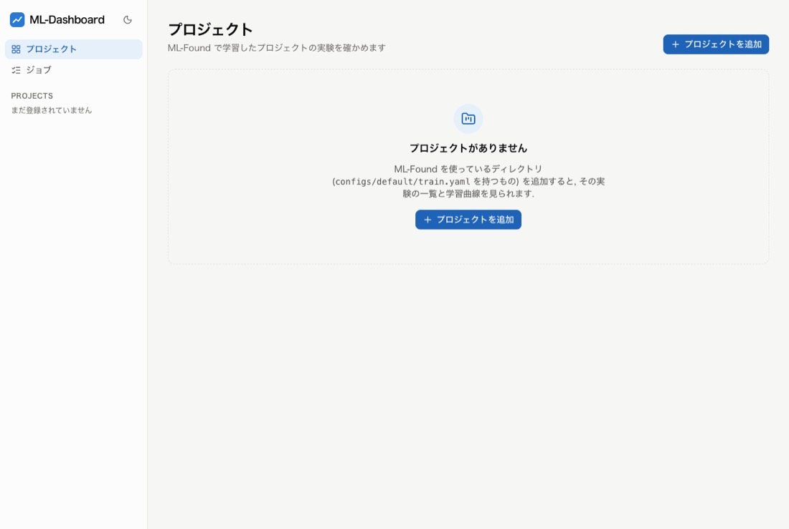

## 2. プロジェクトを登録する

プロジェクトは, ML-Found を使っているディレクトリ (`configs/default/train.yaml` を持つもの). 親のディレクトリを指定すると, まとめて登録できる.

1. 「プロジェクトを追加」を押す
2. パスの欄に ML_tester を clone したディレクトリの `tasks` のパスを入れて (`~` から書ける) 「探す」を押す. 3 階層下までのプロジェクトが並ぶ (`outputs` や `data` の中は探さない)
3. 全て選ばれた状態で「12 件を追加」を押すと, 左の「PROJECTS」に 12 のタスクが並ぶ. 数字は実験の数

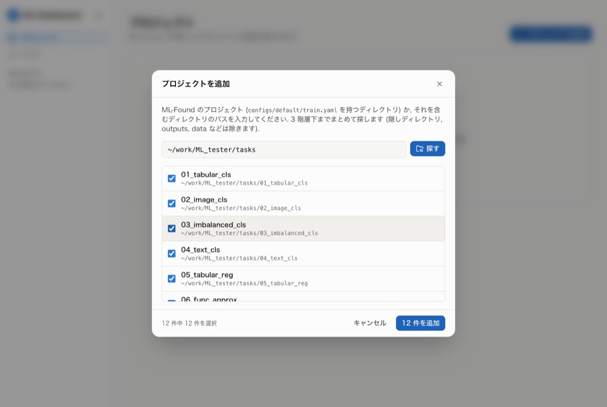

一度登録したプロジェクトは, ダッシュボードを起動し直しても残る.

> **ダッシュボードはプロジェクトに書き込まない**
> 登録の情報, メモ, タグ, 画面で書き換えた config は `~/.ml-dashboard/` (`ML_DASHBOARD_HOME` で変えられる) に保存する. プロジェクトのディレクトリには, 学習を止めるときの `STOP` のファイル以外は何も書かない.

## 3. 実験の一覧

左でプロジェクトを選ぶと, そのプロジェクトの実験 (ML-Found が `outputs/` に残したディレクトリ) が新しい順に並ぶ.

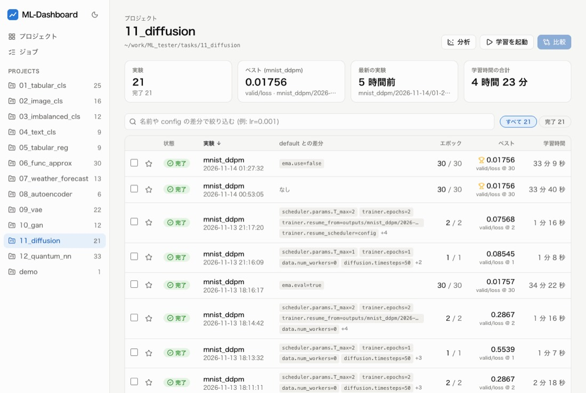

- **上のカード**: 実験の数, ベストの実験, 最新の実験, 学習時間の合計
- **default との差分**: その実験で default の config から変えた項目. 実験を見分ける一番の手がかりになる
- **絞り込みと並べ替え**: 状態 (「すべて」「完了」など) と, 差分の文字で絞り込む. 見出しを押すと並べ替える
- **星とタグ**: 実験を開いて「メモやタグを追加」から付ける. 一覧で星とタグで絞り込める
- **右上のボタン**: 「分析」「学習を起動」「比較」

## 4. 実験の詳細

一覧で実験を押すと詳細が開く. 上にベストの値, エポック, 学習時間, パラメータ数, デバイス, 最終の値が並び, その下のタブで中身を見る.

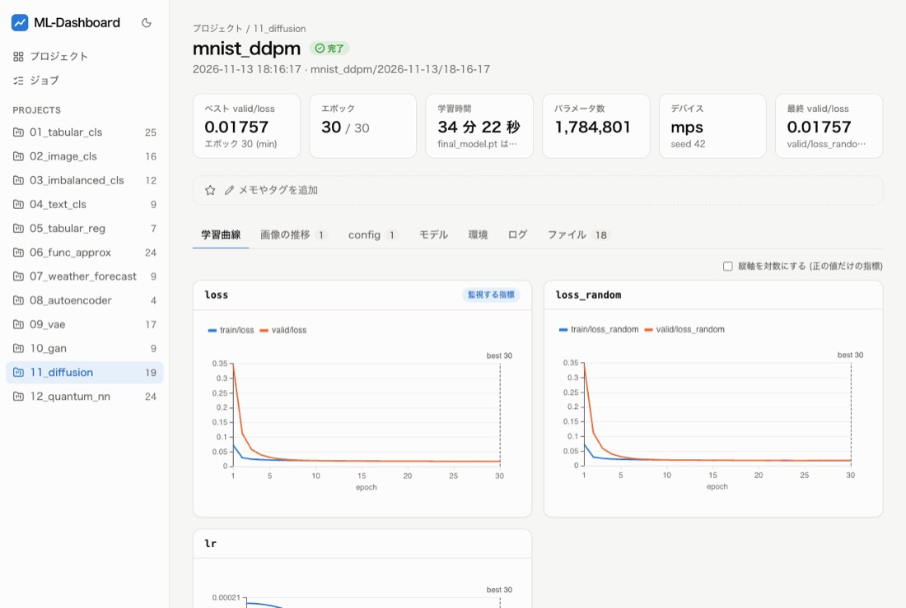

| タブ | 見るもの |
| --- | --- |
| 学習曲線 | 指標ごとに学習用と検証用を重ねたグラフ. `train_eval/` (学習用データを推論モードで評価し直した値) があれば 3 本目として重なる. 「監視する指標」の印とベストのエポックの縦線が付く. 拡大と対数の縦軸. step ごとに学習率を変えた実験は, 学習率のグラフにエポックの中の変化も重なる |
| 画像の推移 | `samples/epoch_010.png` のように番号の付いた画像を, スライダーと再生で順に見る (生成モデルのサンプルなど) |
| config | default との差分と, config 全体 (検索できる). ML-Found が補った値 (`auto` や warmup の回数) もここに出る |
| モデル | モデルの構造, Optimizer, Scheduler と, パラメータの一覧 (名前, 層, 形, 要素数, 学習するか, 重みの共有) |
| 環境 | プロジェクトと ML-Found の git の情報, OS, PyTorch, パッケージ, 学習時の未コミットの変更 |
| ログ | `train.log` を警告とエラーで絞り込み, 検索する |
| ファイル | 実験のディレクトリのファイルの一覧. 画像とテキストはその場で開け, ダウンロードもできる |

<table>
  <tr>
    <td>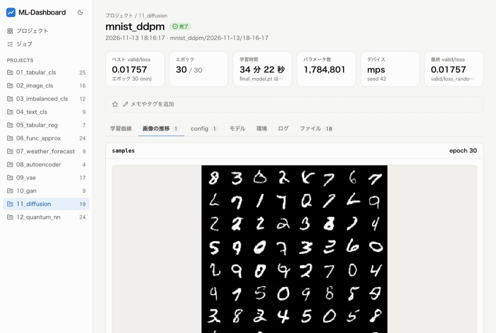</td>
    <td>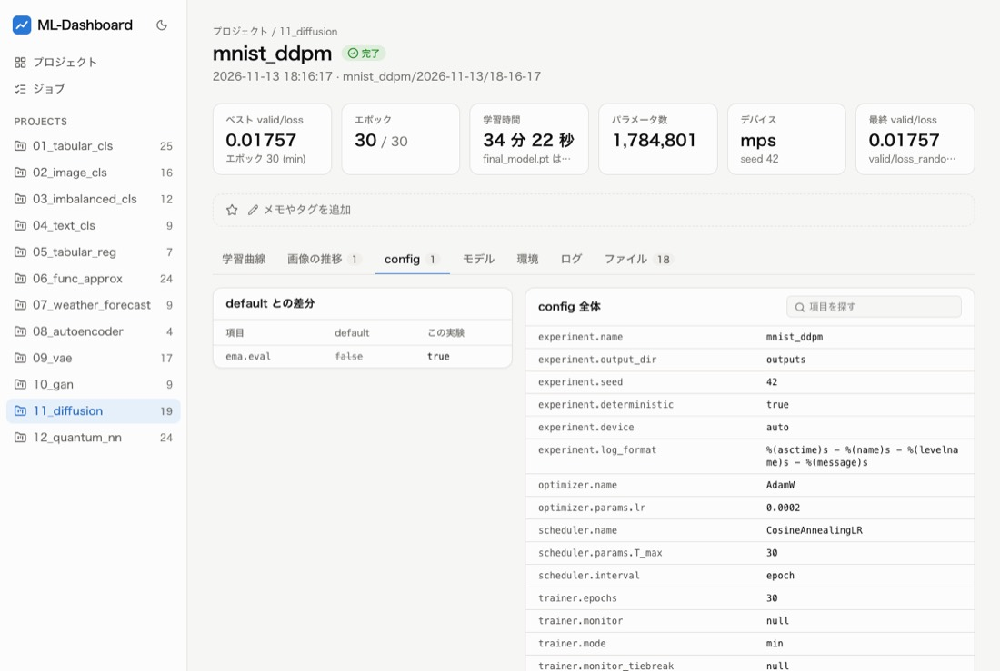</td>
  </tr>
  <tr>
    <td>画像の推移. スライダーでエポック 10, 20, 30 の生成画像を見比べる</td>
    <td>config. この実験は default から <code>ema.eval</code> だけを変えている</td>
  </tr>
</table>

### やってみる 1: 学習用データの評価し直しを見る (3 分)

- [ ] `03_imbalanced_cls` を開き, 差分が `trainer.eval_train=true` の実験 (`examples/eval_train.yaml`) を開く
- [ ] 学習曲線の `auc` で, `train/auc`, `train_eval/auc`, `valid/auc` の 3 本を見比べる
- [ ] 「モデル」のタブで, パラメータの一覧と要素数の合計を見る

**見どころ**: 学習中の値 (`train/auc`) は Dropout が効いた状態の予測なので, 推論モードで評価し直した値 (`train_eval/auc`) より低く出やすい. 評価し直した値と検証用の値を比べると, 過学習しているかどうかが分かる.

### やってみる 2: 量子回路の層の重みを見る (2 分)

- [ ] `12_quantum_nn` の default の実験 (差分が `なし`) を開き, 「モデル」のタブを開く
- [ ] モデルの構造では `TorchConnector()` としか出ない層が, パラメータの一覧では重み 6 個として出ることを確かめる

**見どころ**: 2 行目に「qnn.qnn_est.weight と共有」と出る. 同じ重みを 2 つの名前で持っているので, 学習するパラメータ数は 6 (2 回は数えない).

## 5. 実験を比べる

一覧で 2 つ以上の実験の行のチェックを入れ, 上の「比較 (n)」を押す. 8 つまで選べる.

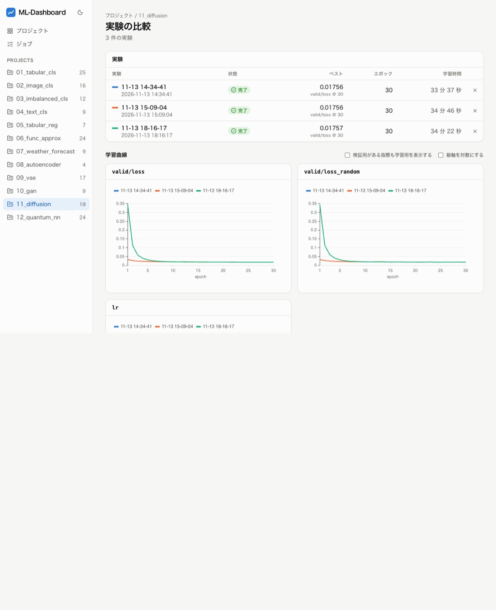

学習曲線は指標ごとに実験を重ね, 同じエポックの生成画像を横に並べ, config の違う項目だけを表にする.

- 検証用がある指標は, 既定では検証用だけを出す. 「検証用がある指標も学習用を表示する」で学習用も出る
- config の違いの表の `—` は, その実験の config にその項目が無かった (古い版の ML-Found で流した) ことを表す

### やってみる 3: EMA で検証した効果を比べる (5 分)

- [ ] `11_diffusion` の一覧で, 差分が `なし` (default), `ema.use=false` (`no_ema.yaml`), `ema.eval=true` (`ema_eval.yaml`) の 3 つにチェックを入れて「比較 (3)」を押す
- [ ] `valid/loss` のグラフで, EMA の重みで検証した実験だけ最初が高く, その後は一度も上がらないことを見る (縦軸を対数にすると分かりやすい)
- [ ] 画像の比較で, エポック 10 の生成画像を 3 つ並べて見る

## 6. ハイパーパラメータの分析

一覧の「分析」から開く. 同じ名前の実験で値を変えた config の項目と, 結果 (ベストや最後の指標) の関係を散布図と値ごとの表で見る.

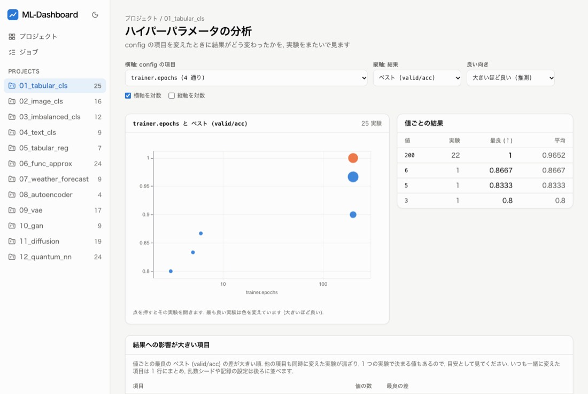

- 横軸に config の項目, 縦軸に結果を選ぶ. 点を押すとその実験が開く
- 下の「結果への影響が大きい項目」は, 値ごとの最良の差が大きい順. 他の項目も同時に変えた実験が混ざるので目安
- 項目の横の `一部の実験だけ` は, その項目を持たない実験 (古い版の ML-Found で流したもの) があることを表す. `記録や環境` は結果に関係しない設定 (デバイス, 保存の設定など)

## 7. 画面から学習を起動する

一覧の「学習を起動」から開く. 学習のスクリプトと experiment の config を選び, フォームか YAML の欄で書き換えてから, ML-Found で確かめて起動する.

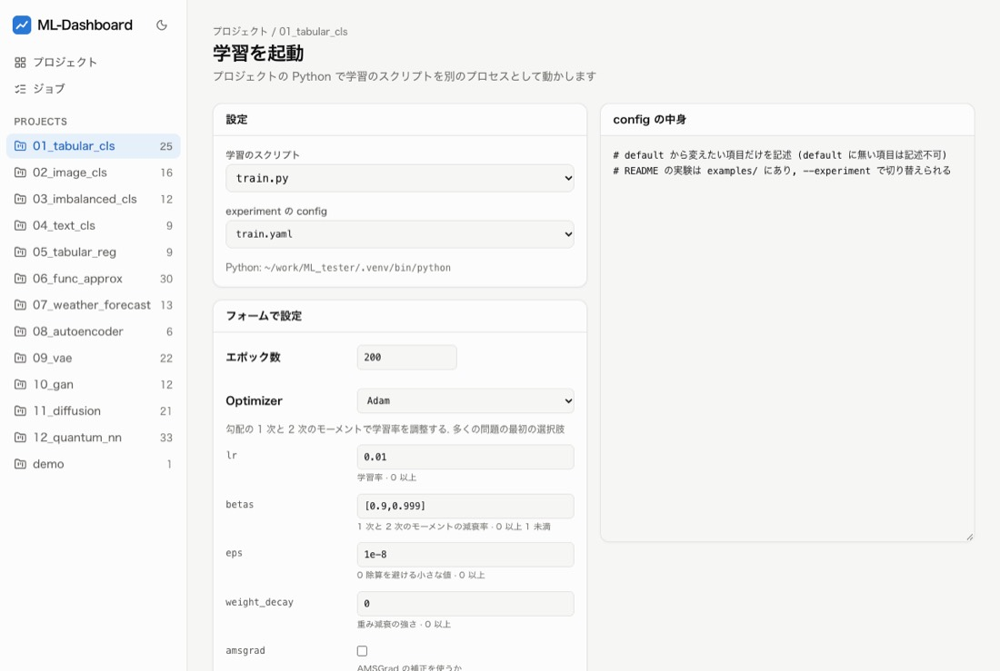

1. **学習のスクリプト** と **experiment の config** を選ぶ. 学習は, プロジェクトの Python (ML_tester なら clone したディレクトリの `.venv`) で別のプロセスとして動く
2. **フォーム** でエポック数, Optimizer と Scheduler とその引数を変える. 引数には ML-Found の登録簿の説明と範囲が付き, `*` は必須. 数の欄には `auto` とも書ける (学習全体のステップ数で補う引数だけ). フォームで変えた値は YAML の欄にも書き込まれる
3. フォームに無い項目 (warmup, `trainer.eval_train` など) は, 右の YAML の欄に直接書く
4. 「ML-Found で config を確かめる」を押す. 結果は 3 種類で出る
    - **誤り**: このままでは起動できないもの (存在しない項目, 範囲の外の値, 作れない Optimizer など). 値の誤りはフォームの該当する欄にも出る
    - **注意**: 起動はできるが確かめたいもの (学習率が下がりきらない, など)
    - **お知らせ**: ML-Found が学習を始めるときに補う値 (`auto`, warmup の回数など)
5. 誤りが無ければ「学習を開始」を押す. ジョブの画面に移る. 画面で書き換えた config はダッシュボードの置き場に保存して渡すので, プロジェクトの config のファイルは変わらない

<table>
  <tr>
    <td>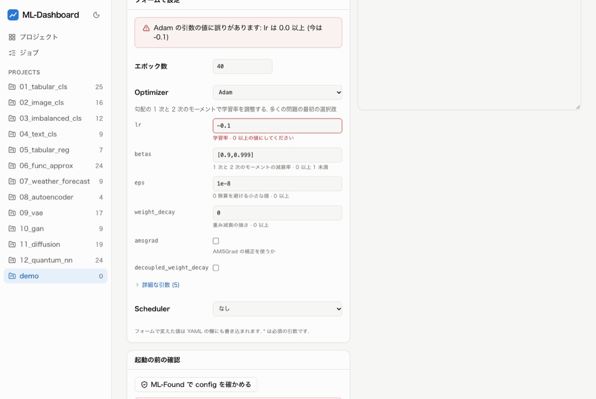</td>
    <td>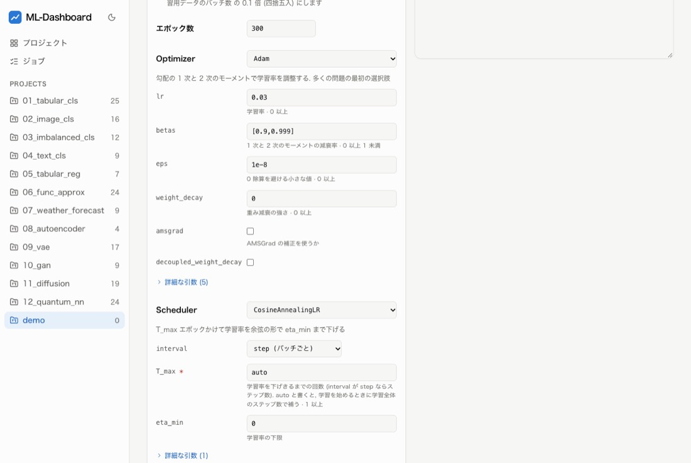</td>
  </tr>
  <tr>
    <td>誤りの例. <code>lr: -0.1</code> は「lr は 0.0 以上 (今は -0.1)」と出て, フォームの lr の欄も赤くなる</td>
    <td><code>T_max: auto</code> と <code>warmup_ratio: 0.1</code> を書いた例. 確かめると, 補う値がお知らせに出る</td>
  </tr>
</table>

> **GPU を使う学習は 1 つずつ**
> 画面から起動した学習も, 端末から流す学習と同じく GPU を使う. 重い学習を同時に 2 つ動かすと, どちらも遅くなる. 試すときは, CPU で数秒で終わる `demo` のプロジェクトか, `01_tabular_cls` の `examples/cpu.yaml` が手軽.

### やってみる 4: 確かめる, 起動する (5 分)

- [ ] `01_tabular_cls` で「学習を起動」を開き, config に `examples/cpu.yaml` を選ぶ
- [ ] フォームの lr を `-0.1` にして確かめ, 誤りの出方を見る. 「元に戻す」で YAML を最初に戻せる
- [ ] YAML の欄に次の Scheduler を書いて確かめ, お知らせを見る
- [ ] 「学習を開始」を押し, 終わったら「実験を開く」から学習率のグラフ (warmup で上がってから下がる) を見る

```yaml
scheduler:
  name: CosineAnnealingLR
  interval: step
  params:
    T_max: auto
  warmup_ratio: 0.1
```

## 8. 進み具合を見て止める

画面から起動した学習は「ジョブ」に並ぶ. エポックとバッチの進捗バー, 残り時間の目安, 標準出力の末尾が見られ, 止め方を 3 つから選べる.

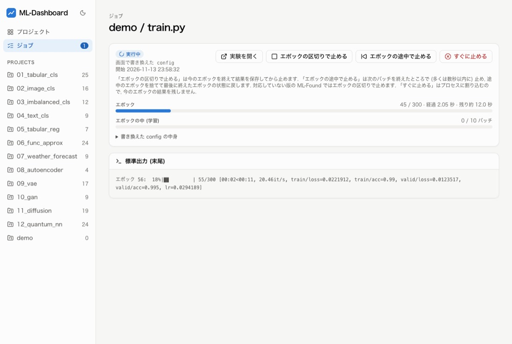

学習中の実験は, 一覧と学習曲線も自動で更新される.

| ボタン | 止まり方 | 残るもの |
| --- | --- | --- |
| エポックの区切りで止める | 今のエポックを終えてから止める | そのエポックまでの記録と `last.pt`. 状態は「中断」. `last.pt` から再開できる |
| エポックの途中で止める | 次のバッチを終えたところ (多くは数秒以内) で止め, 途中のエポックを捨てる | 最後に終えたエポックの状態 (重み, Optimizer, Scheduler, 乱数) に戻して結果を保存する |
| すぐに止める | プロセスに割り込む (Ctrl-C と同じ) | 今のエポックの結果は残らない. 状態は「中断」 |

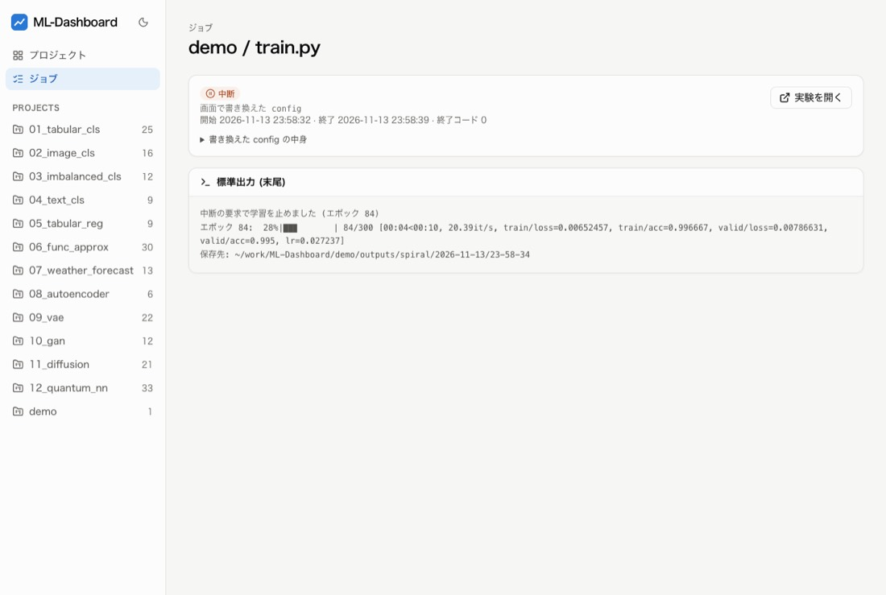

### やってみる 5: 3 つの止め方を試す (5 分)

- [ ] ML-Dashboard の中の `demo` のディレクトリを, プロジェクトとして登録する. 学習は CPU で数秒
- [ ] エポック数を 300 にして起動し, 途中で「エポックの区切りで止める」を押す. 実験の一覧で状態が「中断」になることを見る
- [ ] もう一度起動して「エポックの途中で止める」を押し (確認が出たら OK), 実験の「ログ」に「状態はエポック … のものに戻しました」と出ることを見る

## 9. 困ったとき

| 症状 | 対処 |
| --- | --- |
| 画面を開いても一覧が出ない, 読み込めない | トークン付きの URL (`/api/auth?token=…`) を開き直す. 起動し直すとトークンが変わる |
| ポート 8765 が使われている | `make serve PORT=8800` のように別のポートで起動する |
| ダッシュボードを止めたい | `make serve` を動かしている端末で Ctrl-C を押す. 画面から起動した学習は, 先にジョブの画面で止めておく |
| 実験の一覧に新しい実験が出ない | ブラウザを再読み込みする. 学習中の実験は自動で更新される |
| 登録したプロジェクトを外したい | 「プロジェクト」の画面で, カードの「登録を外す」のボタンを押す. 実験のファイルは消えない |
